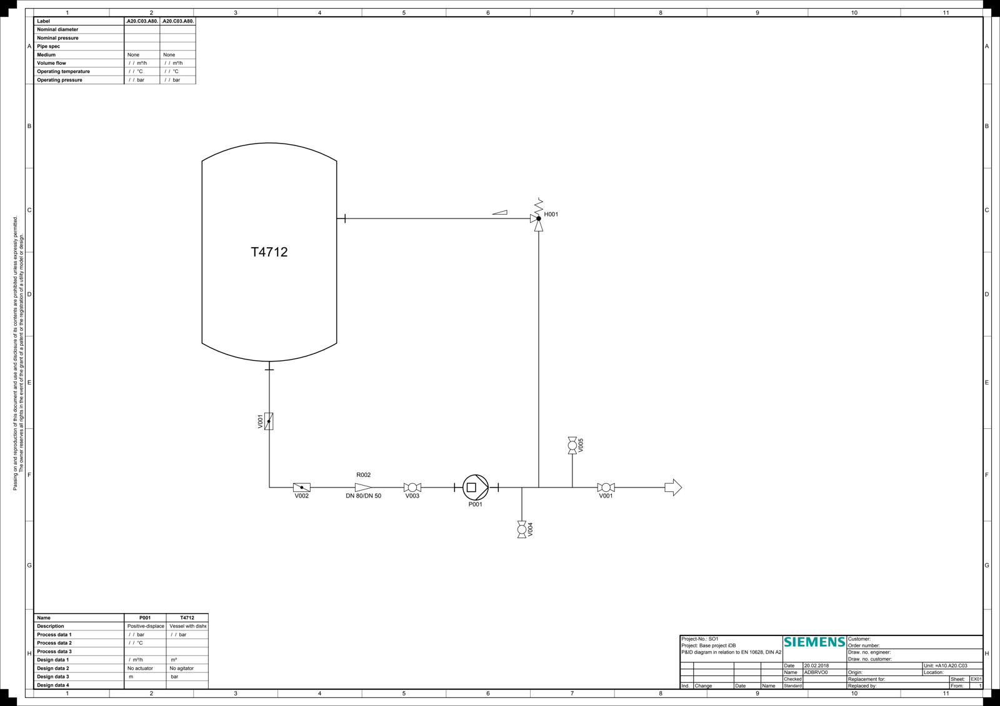
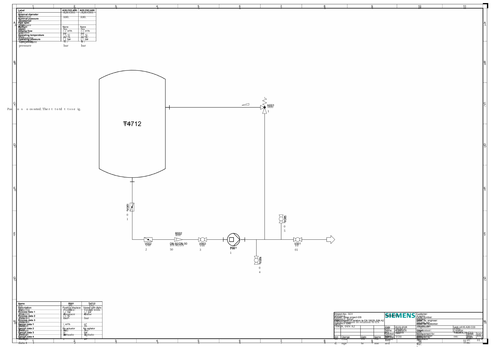
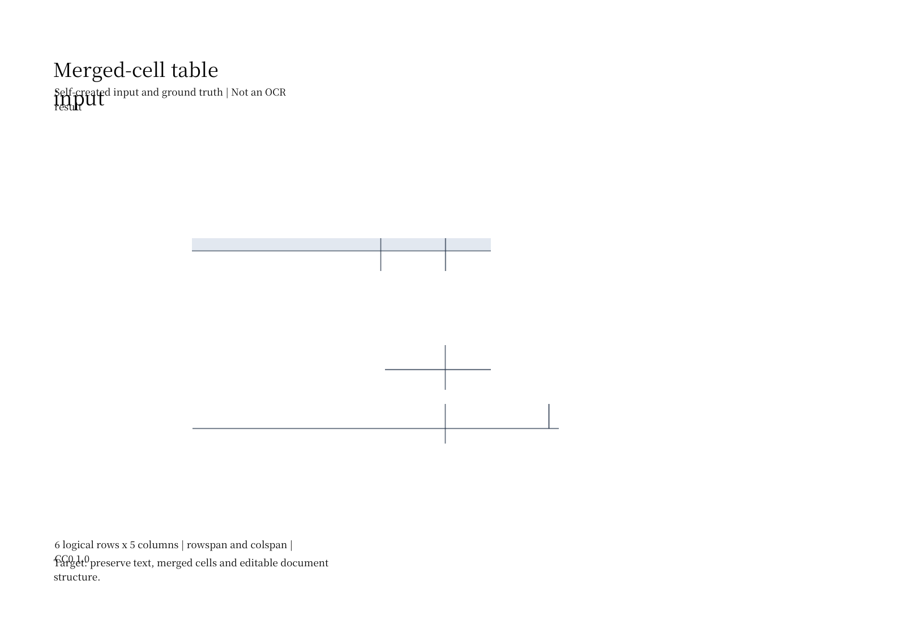
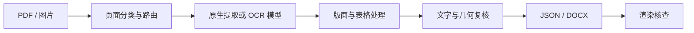
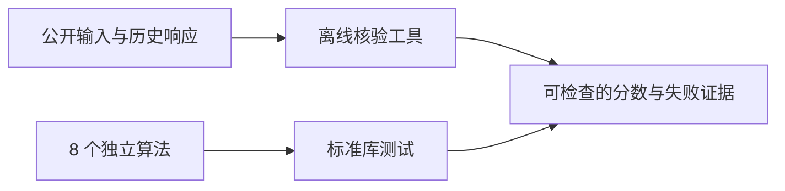

# OCR 与文档结构化：精选代码与实测案例

展示 PDF、扫描页和工程图处理中可独立阅读、运行的关键算法，以及实际服务保存的输入、OCR JSON、DOCX 和渲染预览。

**公开范围：8 个算法片段、独立测试、离线核验工具、公开案例与历史测量记录。** 完整 OCR 服务、模型权重、训练数据和生产部署配置不在本仓库内。

**Python · 文档结构化 · 工程字符复核 · 表格跨度 · DOCX 交付核查**

[快速开始](docs/GETTING_STARTED.md) · [8 个算法](examples/README.md) · [架构与公开范围](docs/ARCHITECTURE.md) · [限制](docs/LIMITATIONS.md) · [Agent / RAG 项目](https://github.com/YSADF/agent-rag-showcase)

## 先看一个可检查的结果

2026-10-07，完整项目服务处理一张自制合并表格：**文字完全匹配 19/21 格，行列及跨度匹配 21/21 格，5 个合并关系全部匹配。** 两处 `Ø` 被识别为 `∅`；生成的 DOCX 经 LibreOffice 渲染后仍有文字缺失和边框问题，视觉验收未通过。

| 输入 | 保存的模型结果 | 实际文档输出 |
|---|---|---|
| [DEXPI 工程图 PNG](samples/c03-raster.png) | [OCR JSON](artifacts/gpu-20261007/engineering-response.json) | [DOCX](artifacts/gpu-20261007/engineering-output.docx) · [失败预览](artifacts/gpu-20261007/engineering-render/page-1.png) |
| [自制表格扫描 PDF](samples/merged-table-scan.pdf) | [OCR JSON](artifacts/gpu-20261007/merged-table-response.json) · [逐格评分](artifacts/gpu-20261007/quality.json) | [DOCX](artifacts/gpu-20261007/merged-table-output.docx) · [失败预览](artifacts/gpu-20261007/merged-table-render/page-1.png) |

这些是**历史完整服务的实测产物**。本仓库的离线核验可以重新检查公开证据，不能证明当前精选代码已重跑完整 OCR 或修复了 Word 问题。

## 无需 GPU 的第一步

进入本仓库根目录，用 Python 运行：

```bash
python -X utf8 tools/verify_demo.py
python -X utf8 -m unittest discover -s tests -v
python -X utf8 examples/literal_guard.py
```

这三条命令使用标准库，不安装模型、不连接 OCR 服务。它们核验保存的案例、运行独立算法测试，并演示已确认字符片段的保护。

代码以 Python 3.11+ 为设计目标；本次整理使用 Python 3.12.14 检查。Windows 也使用上面的 `-X utf8`，避免默认控制台编码无法输出 `Ø、∅、±` 等字符。更多步骤见[运行指南](docs/GETTING_STARTED.md)。

## 输入和失败预览

| DEXPI 工程图 | 自制合并表格 |
|---|---|
|  |  |
| [输入与 OCR 分析](cases/engineering-pdf.md) | [21 个单元格分析](cases/merged-table.md) |

下面两张图来自实际 DOCX 经 LibreOffice 转 PDF 后的页面渲染，保留失败状态：

| 工程图：文字重叠 | 表格：文字缺失、边框不完整 |
|---|---|
|  |  |

Microsoft Word 尚未参与该次验证；不能把 LibreOffice 的结果推断为所有客户端表现，也不能把 DOCX 成功生成等同于交付达标。

## 公开的 8 个算法

每个文件针对一个问题，保留输入、输出和失败边界。它们不组合成完整服务。

| 文件 | 解决的问题 | 主要边界 |
|---|---|---|
| [PDF 路由](examples/pdf_routing.py) | 根据文字层密度选择直接转换或 OCR，并提示扫描页风险 | 读取真实 PDF 需另装 PyMuPDF |
| [Copy-fit](examples/copy_fit.py) | 在有限字号、行数和缩放候选中寻找放得下的文本布局 | 默认测量是估算；`fits` 仍需渲染核查 |
| [字符保护](examples/literal_guard.py) | 保护已确认的编号、尺寸等原始字符片段 | 不判断 OCR 符号是否识别正确 |
| [工程字符评分](examples/engineering_metrics.py) | 保留 Unicode 差异，分别统计转写和待复核状态 | 不包含检测器或整页定位评分 |
| [公差关联](examples/engineering_tolerances.py) | 按坐标、方向与表格边界关联已观测片段 | 不补写缺失的直径或正负号 |
| [VLM 候选证据](examples/vlm_evidence.py) | 并列保存首次识别和候选，并保留疑点 | 不自动改字或解除复核 |
| [VLM 几何检查](examples/vlm_geometry.py) | 校验区域坐标、单元格位置与跨度 | 坐标合法不代表识别正确 |
| [VLM 兜底策略](examples/vlm_fallback_policy.py) | 风险排序、失败输出检查、权重身份与关键修改检查 | 不含模型加载、完整调度或自动写回 |

[示例说明](examples/README.md)给出调用方式；[代码来源清单](CODE_PROVENANCE.json)记录裁剪来源与摘要。模型本身来自第三方开源项目，公开工作集中在流程、适配、校验与评测。

## 背景系统与本仓库的关系

下面是完整系统的背景流程，用于解释算法的位置；流程中的服务和模型不会随展示仓一起安装。



当前仓库可直接运行的路径是：



HTTP 测试客户端可连接用户已有的兼容服务，但仓库本身不提供服务端。详细组件边界见[架构说明](docs/ARCHITECTURE.md)。

主要目录按代码、输入和证据组织：

```text
examples/               8 个独立算法
tests/                  算法与工具测试
tools/                  离线核验、样本准备和可选 HTTP 客户端
samples/                有来源与许可说明的输入
assets/                 输入预览
artifacts/              冻结的 JSON、DOCX、渲染与历史测量
cases/                  分案例和实验轮次的分析
docs/                   运行、架构、限制、验证与发布说明
PUBLISH_MANIFEST.json   逐文件发布清单与摘要
```

## 历史测量的范围

2026-10-07 基线使用单张 RTX 5090 32 GB，实际识别后端为 **PP-OCRv6 small**。每例预热 2 次、串行测量 20 次，固定 `balanced / en / use_layout=true`。

| 固定案例 | JSON 请求成功 | P50 / P95 | 质量结论 |
|---|---:|---:|---|
| DEXPI C03 工程图 | 20/20 | 4.164 / 4.433 秒 | 主要编号可读，小字和长说明有遗漏、截断 |
| 自制合并表格 | 20/20 | 1.793 / 1.919 秒 | 文字 19/21；结构 21/21；DOCX 视觉检查失败 |

表格 CER 为 `2/203 = 0.985%`。这些数据只描述两个固定输入；重复请求不增加准确率样本数，也不能推导生产并发或总体质量。[环境、口径与原始测量](EVALUATION.md)

其他历史实验按各自数据集、参数与日期保存，不合并成一个总准确率：

| 记录 | 关注点 |
|---|---|
| [真实图纸摸底，2026-10-08](cases/real-engineering-drawings.md) | 20 页、238 个选定区域；机械与 P&ID 分开统计 |
| [机械优化第二轮](cases/mechanical-ocr-round2.md) | 零件表恢复、漏直径拦截与上下公差 |
| [VLM 第三轮](cases/engineering-vlm-round3.md) | 局部裁剪与整页方案分别评测，保留失败 |
| [局部兜底第四轮](cases/engineering-fallback-round4.md) | 按疑点路由；本地验证和未执行的 GPU 项分别记录 |

工程 VLM 是可选研究方向，精选策略文件不等于已部署的自动纠错器。第四轮保存记录中 GLM-OCR、MinerU 和 FormulaNet 的新模型推理尚未执行；不提供它们的本项目准确率。

## 可选：生成样本或连接已有服务

样本再生成需要额外依赖，输出写到独立目录：

```bash
python -X utf8 -m pip install -r requirements-demo.txt
python -X utf8 tools/prepare_examples.py --out-dir generated/demo --dpi 180
```

读取真实 PDF 路由需安装 `requirements-pdf.txt`。这些依赖不属于前面的标准库 Quickstart。

已有兼容 OCR 服务时，可单次复测公开输入：

```bash
python -X utf8 -m pip install -r requirements-client.txt
python -X utf8 tools/benchmark_service.py --base-url http://127.0.0.1:8089 --output-dir generated/benchmark --runs 1 --warmup 0
```

认证读取环境变量 `PPOCR_API_KEY`，不要写进代码或公开报告。该客户端会发送案例文件并请求 JSON 和 DOCX。输出目录必须尚不存在，防止覆盖历史或先前结果；再次运行时改用新目录。单次运行不能形成稳定的 P95 结论。

## 已知限制与下一步

- 工程字符存在高置信度误读；不能全局替换 `∅ → Ø`，也不能用模型一致代替正确性验证。
- JSON 结构与 Word 显示需要分别验收；本仓库保留已发现的输出问题。
- 后续真实图纸属于开发／回归集，尚无独立人工校对的正式验收集。
- 部分历史图纸只公开来源、哈希与派生评分，不能从评分数据重建完整推理。
- 完整服务、模型权重和训练流程不在公开范围；本仓库不提供生产部署承诺。

后续优先补独立人工标注、工程符号与公差失败样本，以及 Word/LibreOffice 的交付核查。[完整限制](docs/LIMITATIONS.md)

## 来源与许可

- `examples/`、`tests/` 与实测/评分客户端采用 [MIT](CODE_LICENSE.txt)。
- 原创说明和独立样本准备工具采用 [CC BY 4.0](LICENSE.md)。
- 自制合并表格输入及结构真值采用 CC0；DEXPI 输入与衍生数据保留上游许可和归属。
- 其他真实工程图纸不随仓库再分发，不适用自制样本的许可。

[样本来源与许可详情](CASE_SOURCES.md) · [代码来源](CODE_PROVENANCE.json) · [Agent / RAG 展示项目](https://github.com/YSADF/agent-rag-showcase)

[本次验证记录](docs/VALIDATION.md) · [贡献方式](CONTRIBUTING.md) · [独立发布流程](docs/PUBLISHING.md)
