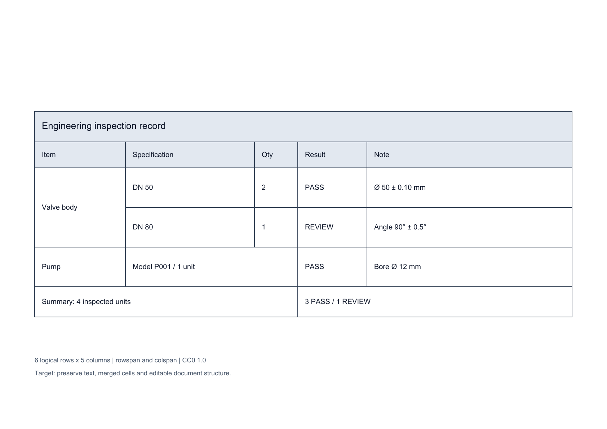

# OCR Document Showcase

面向处理扫描文档与工程图的开发者，用 8 个独立算法和真实输入输出，展示 OCR、英译中与中文 Word 排版的工程核查。

[快速开始](#快速开始) · [中文 Word 案例](cases/reviewed-translation-20261027.md) · [精选代码](examples/README.md) · [技术说明](docs/ARCHITECTURE.md)

**公开范围：8 个算法片段、案例产物与核验工具。** 完整 OCR／翻译服务、业务排版代码和模型权重不公开。

## 先看原文与中文 Word

**两例中文 Word，直接对照英文原页。** PLOS 保持一页双栏与蓝底摘要框，表格使用原生 Word 单元格，保留原页位置与合并关系。下方图片来自实际 DOCX 的独立渲染；严格检查与逐页目视未见叠字、裁切或溢出。

| 原文档 | 中文文档效果 | 可直接查看 |
|---|---|---|
| [PLOS 第 2 页](samples/plos-best-practices-page-2.png) | 一页双栏；蓝底摘要框、标题与完整页脚 | [译文 JSON](artifacts/reviewed-translation-20261027/plos/reviewed.json) → [中文 DOCX](artifacts/reviewed-translation-20261027/plos/output.docx) · [预览 PDF](artifacts/reviewed-translation-20261027/plos/render/output.pdf) |
| [合并表格扫描 PDF](samples/merged-table-scan.pdf) | 一页原生 Word 表格；21 个单元格、5 处合并；格内文字与数字均为原生内容 | [逐格内容](artifacts/native-table-20261027/targets.json) → [中文 DOCX](artifacts/table-display-20261027/output.docx) · [预览 PDF](artifacts/table-display-20261027/render/output.pdf) |

### PLOS：英文原页 → 中文 Word

| 英文原页（论文第 2 页） | 中文 Word 的实际渲染 |
|---|---|
| [](samples/plos-best-practices-page-2.png) | [](artifacts/reviewed-translation-20261027/plos/render/page-1.png) |

[完整原始 PDF](samples/plos-best-practices-source.pdf) · [中文 DOCX](artifacts/reviewed-translation-20261027/plos/output.docx) · [预览 PDF](artifacts/reviewed-translation-20261027/plos/render/output.pdf) · [案例说明](cases/reviewed-translation-20261027.md)

### 合并表格：英文表格 → 中文 Word

| 英文表格（自制样本） | 中文 Word 的实际渲染 |
|---|---|
| [](artifacts/table-display-20261027/english/page-1.png) | [](artifacts/table-display-20261027/render/page-1.png) |

[原始扫描 PDF](samples/merged-table-scan.pdf) · [中文 DOCX](artifacts/table-display-20261027/output.docx) · [预览 PDF](artifacts/table-display-20261027/render/output.pdf) · [案例说明](cases/reviewed-translation-20261027.md)

表格已改为 **原生 Word 表格**：格内文字、数量、边框与合并关系均为 Word 对象；没有表格背景图或表内文字框。`DN 50／DN 80`、数量 `2／1` 和“合格／待复核”均在真实单元格中。字体、局部字号与原文有差异，Microsoft Word 交互编辑未验收。[结构与内容检查](cases/reviewed-translation-20261027.md)

最终中文文档与[原始模型输出](cases/faithful-translation-20261027.md)分别保存；[PLOS 生成记录](artifacts/reviewed-translation-20261027/run.json)、[表格更新记录](artifacts/table-display-20261027/run.json)和[输入与字体许可](CASE_SOURCES.md)可追溯。基础 OCR／翻译实测使用 RapidOCR / ONNX Runtime 和 Argos `translate-en_zh` 1.9 / CTranslate2 4.5.0 CPU int8。

[旧三页单栏版本](cases/english-to-chinese-20261026.md)、[原文导出修复](cases/docx-export-fix-20261026.md)和[首次 CPU 失败](cases/local-cpu-20261026.md)作为历史对照保留。下方最小命令只核验保存结果和运行独立算法，不启动完整私有服务。

## 可以从这里得到什么

- **核查真实结果：** 对照输入、OCR、原始翻译响应、中文 DOCX 与渲染预览，区分识别、翻译和显示问题。
- **理解输入路由：** 用独立 PDF 路由片段比较原生文字 PDF 与扫描 PDF；它只给出决策，不执行转换。
- **保护并评分工程字符：** 保留编号和公差的原样片段，区分 `Ø`、`∅` 等 Unicode 字符，不用候选一致替代正确性。
- **运行小范围算法：** 8 个片段覆盖路由、Copy-fit、公差关联及候选检查，默认示例和测试只需 Python 标准库。

## 快速开始

需要 **Git、Python 3.11+**；无 GPU、模型或 API Key 要求。获取源码需要联网，以下核验和示例可离线运行：

```bash
git clone https://github.com/YSADF/ocr-document-showcase.git
cd ocr-document-showcase
python -S -X utf8 -B tools/verify_demo.py
python -S -X utf8 -B examples/literal_guard.py
python -S -X utf8 -B -m unittest discover -s tests -v
```

核验结果输出到终端：`ok` 表示原始公开证据一致，`local_run`、`local_docx_fix`、`local_translation`、`local_faithful` 分别检查首次 CPU、原文修复、历史单栏翻译和原页版式机器输出；执行标记为 `false` 表示核验本身不执行新 OCR、翻译或渲染。最终中文文档也纳入显式发布清单，可用 `python -S -X utf8 -B tools/check_publication.py` 核查文件完整性；这不判断译文是否正确。字符保护示例展示已确认的 `Ø`、`±` 片段如何原样恢复；测试检查公开算法及反例。默认命令不生成或覆盖文件。

`-S` 禁用第三方包加载，`-X utf8` 保证 Windows 工程字符输出，`-B` 避免生成字节码缓存。如果你在完整项目中阅读此文件，先进入 `showcase/` 再运行三条 Python 命令。

[运行指南](docs/GETTING_STARTED.md)包含真实 PDF 路由、可选依赖、输出位置和故障排查。[验证记录](docs/VALIDATION.md)说明实际检查的环境与范围。

## 从三个小例子开始

| 示例 | 适合解决的问题 | 能运行到哪一步 |
|---|---|---|
| [PDF 路由](examples/pdf_routing.py) | 先判断 PDF 是否需要 OCR | 输出路由及原因；读取真实 PDF 需 PyMuPDF |
| [字符保护](examples/literal_guard.py) | 避免已确认的编号、尺寸在下游处理中被改写 | 保护、恢复并核验片段；不纠正上游识别错误 |
| [工程字符评分](examples/engineering_metrics.py) | 精确检查工程文字与待复核状态 | 计算字符差异与聚合分数；不评估整页检测召回 |

其余 5 个片段展示 Copy-fit、公差关联、VLM 候选证据、几何检查和兜底策略。[全部算法与调用方式](examples/README.md)

## 公开内容如何工作


完整系统集成第三方 OCR、版面、表格模型及可配置的翻译后端；本项目工作集中在输入路由、流程编排、结果适配、文档渲染和质量核查。公开片段是从中选取的独立示例，不组合成完整服务，也不包含模型训练实现。

[架构与第三方边界](docs/ARCHITECTURE.md) · [代码来源](CODE_PROVENANCE.json) · [样本来源](CASE_SOURCES.md)

## 输入和失败预览

以下是 **2026-10-07 历史 GPU 基线**，与上面的本地 CPU 实测分开保存。后端、模型和结构处理配置不同，不能把两组分数直接解释为版本提升或退化。

| 历史案例 | 输入 → OCR → 导出 | 阅读重点 |
|---|---|---|
| [自制合并表格](cases/merged-table.md) | [扫描 PDF](samples/merged-table-scan.pdf) → [JSON](artifacts/gpu-20261007/merged-table-response.json) → [DOCX](artifacts/gpu-20261007/merged-table-output.docx) | 文字、位置、跨度分别评分；[渲染缺字与边框问题](artifacts/gpu-20261007/merged-table-render/page-1.png) |
| [DEXPI 工程图](cases/engineering-pdf.md) | [PNG](samples/c03-raster.png) → [JSON](artifacts/gpu-20261007/engineering-response.json) → [DOCX](artifacts/gpu-20261007/engineering-output.docx) | 工程编号与小字识别；[渲染叠字问题](artifacts/gpu-20261007/engineering-render/page-1.png) |

历史预览由 LibreOffice 转 PDF 再渲染，Microsoft Word 未参与当次验证。生成 DOCX 或写入表格 XML 不等于版式保留、编辑体验或交付质量已经通过；图片背景和工程图元也不是可编辑的 CAD 对象。

该次表格文字匹配 19/21、位置及跨度匹配 21/21，仍有两处 `Ø → ∅`，两例 DOCX 均未通过视觉验收；新测量不覆盖这份失败记录。

## 历史测量的范围

2026-10-07 的两个固定样本使用 RTX 5090、PP-OCRv6 small，每例预热 2 次、串行测量 20 次。耗时、环境版本、方法及原始记录集中在[评测说明](EVALUATION.md)，不作为当前公开片段的性能承诺。

后续实验分别保留[真实图纸摸底](cases/real-engineering-drawings.md)、[机械优化第二轮](cases/mechanical-ocr-round2.md)、[VLM 第三轮](cases/engineering-vlm-round3.md)和[局部兜底第四轮](cases/engineering-fallback-round4.md)。数据集、参数和推理状态不同，不合并成一个准确率；第四轮的新模型未执行项继续保留。

## 限制、文档与参与

- 工程字符仍会误读；不能全局替换 `∅ → Ø`，待复核也不等于正确。
- 两个中文单页通过限定版式检查，不代表模型准确率或独立人工认证。字体与局部字号仍有差异；表格已验证原生结构及逐格文字，PLOS 仍使用原页背景加定位文字，Microsoft Word 编辑体验未验收。
- VLM 片段只展示候选检查策略，不启动模型；部分真实图纸没有再分发许可，不能仅凭本仓库重跑所有历史实验。

[完整限制](docs/LIMITATIONS.md) · [运行与排错](docs/GETTING_STARTED.md) · [验证记录](docs/VALIDATION.md) · [贡献方式](CONTRIBUTING.md) · [独立发布流程](docs/PUBLISHING.md)

许可沿用现状：精选代码和测试适用 [MIT](CODE_LICENSE.txt)，文档及素材遵循[分项许可](LICENSE.md)与[来源说明](CASE_SOURCES.md)。未公开业务源码不在授权范围内。另见独立的 [Agent / RAG 展示项目](https://github.com/YSADF/agent-rag-showcase)。
