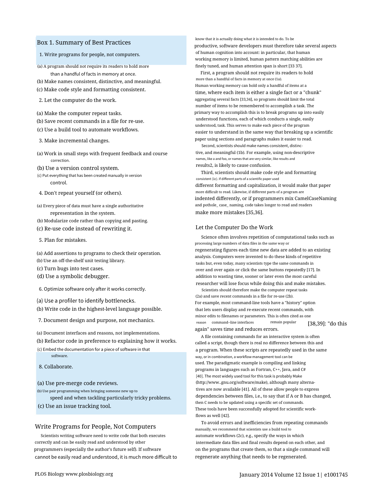
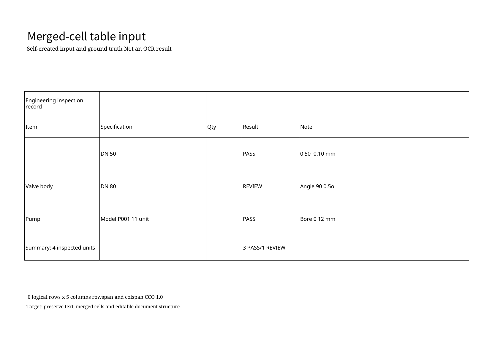

# DOCX 导出修复：正文叠行与表格消失

[首页](../README.md) · [原始失败记录](local-cpu-20261026.md) · [修复运行记录](../artifacts/local-docx-fix-20261026/run.json) · [验证范围](../docs/LIMITATIONS.md)

本轮继续使用同一份 PLOS 第 2 页 PNG 和自制合并表格扫描 PDF，修复完整项目中的 DOCX 渲染逻辑，再从 `DocumentPipeline.process()` 重新识别并调用 `render_result()` 导出。修改对象是渲染器；不手工改写 OCR 文字、表格真值或导出文件，也不以其他模型的结果替换本次预测。

**最终重跑通过本轮限定的导出验收（`passed_for_export_targets`）：PLOS 原有叠行问题消除，表格主体与页脚正常显示。** 两份 DOCX 均经独立 LibreOffice 渲染为一页并逐页检查。该结论不包含完整原版还原、OCR 准确性或 Microsoft Word 编辑体验。

原始失败的 JSON、DOCX、PDF、PNG 和运行记录保留在 `artifacts/local-20261026/`；本轮写入独立目录 `artifacts/local-docx-fix-20261026/`。**验收分别检查正文是否叠行、预测表格能否显示、OCR 内容是否改变，不能由其中一项推导整页版式还原或编辑体验通过。**

## 修复的工程问题

原有绝对定位导出会把源文字套用到较大的通用字号及可扩展文本框中。较密的 OCR 行发生折行后，文本框向下扩展，与下一行重叠。短文字片段的检测框上下边界也可能与同一基线的相邻文字不同。

本轮对未翻译的源文字按原行定位，使用实际字体度量选择能够放入框内的字号，并参考下一行位置限制高度。相邻短片段只在满足同一行的几何条件时对齐。无法放入的行保留明确的适配失败记录；翻译的排版策略不由这两个源文档案例代替验证。

另一个问题在 DOCX 的 VML 文本框声明：旧文件引用 `#_x0000_t202`，却没有对应的 `shapetype` 定义。保留其他内容、只补入类型声明的对照渲染，确认了 LibreOffice 对内边距、填充及自动折行的处理会因此改变。本轮在导出器中补齐声明。原生浮动表格位于文档末尾、紧接节属性时，LibreOffice 可能不显示该表格；本轮在表格后保留一个最小的普通正文段落，确保表格可以正常参与排版。

这些实现仍属于完整项目的私有代码。公开包继续提供原有 8 个算法片段、输入、原始输出和核查证据，没有增加完整渲染器或服务代码。

## 两例分别检查什么

| 检查范围 | PLOS 正文页 | 自制合并表格 |
|---|---|---|
| 用户问题 | 密集多栏文字导出后叠行、异常换行 | DOCX 内已有原生表格，但渲染时主体消失 |
| 固定输入 | 官方 PDF 第 2 页的 200 DPI RGB PNG | 仓库自制的 CC0 扫描 PDF |
| OCR 文字 | 103 条块内文字行；无人工全文准确率金标准 | 23 条块内文字行；19 个非空预测单元格 |
| 旧 DOCX 的 PDF 文字检查 | 102/103 条文字可匹配，但仍大量叠行 | 4/23 条文字可匹配；预测单元格文字 0/19 |
| 本轮 DOCX 与 PDF 文字检查 | 两者均为 103/103 条块内文字行可匹配 | 两者均为 23/23 行、19/19 个非空预测单元格可匹配 |
| 本轮实际页面检查 | 原有正文叠行消除；上下图像区域的叠加文字可见，无先前遮字问题 | 原生表格主体及边框可见，页脚不再重叠 |
| 导出器源行适配诊断 | 111 行，0 项适配失败，包含图像叠加文字 | 4 条非表格文字行，0 项适配失败；表格单独核查 |
| 与旧 OCR 结果比较 | 文字及几何投影一致 | 文字及几何投影一致，表格分数不变 |
| 单独保留的限制 | 图像区域、全文阅读顺序及原版颜色还原 | OCR 字符错误、数量列遗漏和合并关系漏检 |

上述文字匹配与适配诊断是辅助证据，页面检查另外执行；尤其旧 PLOS 的高文字匹配数没有阻止严重叠行。前后 JSON 比较采用明确的文字及几何字段投影，排除计时、置信度和审计元数据，不声称整个 JSON 逐字节相同。完整项目的 77 项相关回归测试通过，范围以[本轮验证记录](../docs/VALIDATION.md)为准。

### PLOS 输入与导出

| 固定输入 | 本轮 DOCX 的真实渲染 |
|---|---|
|  |  |

[原始 JSON](../artifacts/local-docx-fix-20261026/plos/output.json) · [识别文字](../artifacts/local-docx-fix-20261026/plos/recognized.txt) · [DOCX](../artifacts/local-docx-fix-20261026/plos/output.docx) · [渲染 PDF](../artifacts/local-docx-fix-20261026/plos/render/output.pdf) · [内容与结构核查](../artifacts/local-docx-fix-20261026/plos/render-audit.json)

来源、署名、CC BY 4.0 许可和输入制备方法沿用[原始来源记录](../samples/plos-best-practices-source.json)。原生 PDF 文字仅作参考，没有回填 OCR 结果或 DOCX。

修复后的字体、字号和间距仍与原文不同，蓝色摘要背景仍只局部保留。OCR 产生的短片段虽然显示正常，其完整阅读顺序尚未独立验收；页面仍包含保留图像区域。这里通过的是先前叠行与遮字问题的修复检查，不能称整页已完整还原或全部可编辑。

### 表格输入与导出

| 固定输入 | 本轮 DOCX 的真实渲染 |
|---|---|
|  |  |

[原始 JSON](../artifacts/local-docx-fix-20261026/merged-table/output.json) · [逐格评分](../artifacts/local-docx-fix-20261026/merged-table/table-score.json) · [DOCX](../artifacts/local-docx-fix-20261026/merged-table/output.docx) · [渲染 PDF](../artifacts/local-docx-fix-20261026/merged-table/render/output.pdf) · [内容与结构核查](../artifacts/local-docx-fix-20261026/merged-table/render-audit.json)

本轮仍使用 OpenCV 网格回退，预测 30 格，真值为 21 格；文字完全匹配 13/21、位置及跨度匹配 16/21、字符编辑 24/203，5 处合并关系全部漏检。显示原生表格解决的是导出缺失，不能把 30 格预测说成正确还原了原文的 21 格结构。原始的工程字符错误也没有通过渲染修复被悄悄替换。

## 如何检查保存结果

公开仓库中的核验只依赖 Python 标准库，不会启动模型或重新渲染：

```bash
python -S -X utf8 -B tools/verify_local.py --record artifacts/local-docx-fix-20261026/run.json
python -S -X utf8 -B tools/verify_demo.py
```

第一条明确选择本轮记录；不带 `--record` 时仍检查原始失败记录。第二条分别报告旧 `local_run` 与新 `local_docx_fix`，不会覆盖历史结论。`ok=true` 只表示文件哈希、JSON、DOCX 结构和记录中的分数一致，视觉验收状态需要另外阅读。

`render-audit.json` 记录 OCR 行与非空预测单元格在 DOCX XML、渲染 PDF 中的字面匹配，以及页数、字体字号、文本边界和前后 JSON 的文字／几何投影。匹配只删除空白，不合并 Unicode 字符，也不改写识别结果。相同词语可能匹配到同一处文字，PDF 提取顺序也可能产生漏匹配；这些统计不能独立证明准确率、完整性、无重叠或可编辑性。

## 完整项目的运行条件

本轮镜像为 `pp-v5-showcase:docx-fix`，由前轮准备好模型和依赖的 `onnx-only` 镜像加入本轮渲染器修改。镜像构建、运行脚本及完整源码不在公开包中；以下是完整项目环境中使用的接口与约束，不能在精选代码仓库中直接启动全系统。

```python
pipeline = DocumentPipeline()
result = pipeline.process(
    input_path, output_format="json", use_layout=True, absolute_position=True,
    ocr_lang="en", ocr_mode="balanced", ocr_scene="general", vlm_fallback="off",
)
pipeline.render_result(result, "docx", absolute_position=True)
```

输入只读挂载，输出写入独立实验目录；推理容器使用 `--network none --cpus=4 --memory=8g`，不读取现场 `.env`。实际后端沿用 RapidOCR 3.0.0、ONNX Runtime 1.19.2、PP-OCRv3 多语检测与 PP-OCRv4 英文识别，几何版面、OpenCV 表格回退，RapidTable 与 VLM 关闭。模型哈希、实际镜像及执行源码摘要以本轮 `run.json` 为准。

DOCX 在另一个禁网容器中以 LibreOffice 7.4.7.2、Poppler 22.12.0 和原样 `render_docx.py` 渲染，参数为 `--emit_pdf --dpi 144`。原始 DOCX 只读挂载，导出后不手工改字或修饰页面。Microsoft Word 客户端、真实编辑操作、翻译及可搜索 PDF 不在本轮范围内；也不将两个固定输入的结果推广为任意文档的质量保证。
