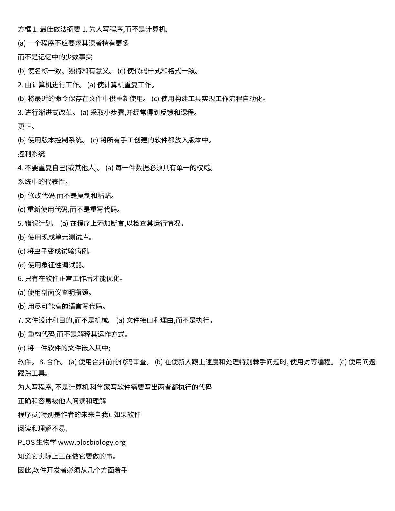
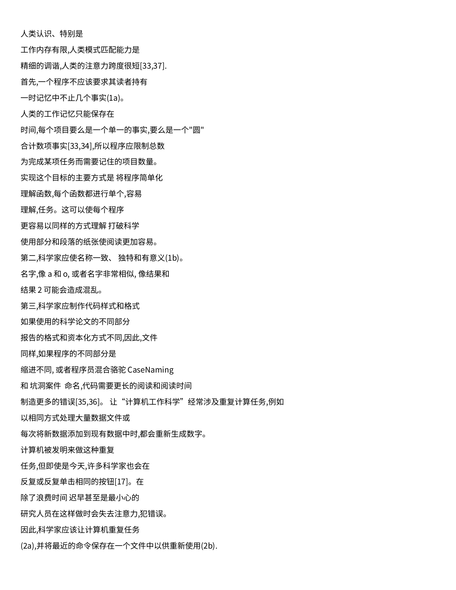
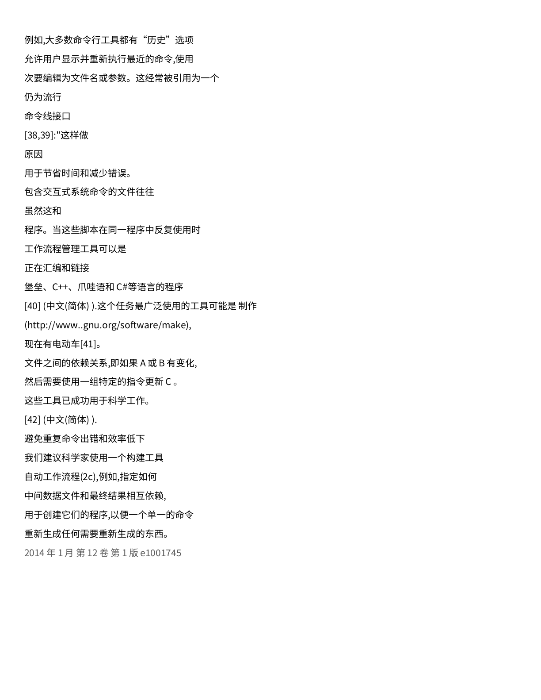
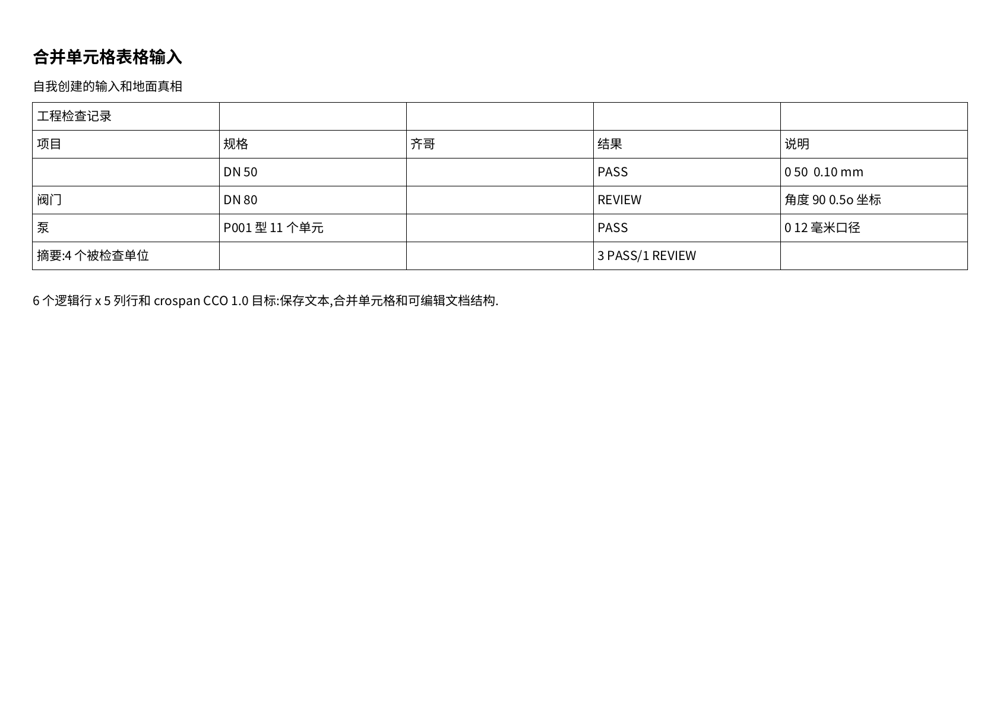

# 英译中与中文 DOCX 导出实测

[首页](../README.md) · [本轮运行记录](../artifacts/local-translation-20261026/run.json) · [原文导出修复](docx-export-fix-20261026.md) · [输入来源与许可](../CASE_SOURCES.md)

2026-10-26，以同一份公开 PLOS 论文页和自制表格重新执行 OCR、英译中、中文 DOCX 导出及独立渲染。**两例通过本轮重叠、溢出和表格显示检查；机器翻译仍有误译与漏译，未通过翻译质量验收。** 没有人工改写模型译文、OCR 结果或最终 DOCX。

中文无法容纳在原文的密集行框时，导出器切换为 10.5 pt 原生段落并自然分页。PLOS 从原来的一页双栏变为三页单栏阅读版；表格仍为一页。这个取舍解决显示问题，不代表原版布局得到保留，也不代表 Microsoft Word 编辑体验已经验收。

## 两例检查了什么

| 检查项 | PLOS 论文第 2 页 | 自制合并表格 |
|---|---|---|
| 用户问题 | 英文多栏正文译成中文后，文字框相互覆盖 | 译文、工程编号和单元格需要一起显示 |
| 输入 | 官方 PDF 第 2 页，固定转为 200 DPI RGB PNG | 自制 CC0 扫描 PDF，有独立结构真值 |
| 本次真实处理 | 英文 OCR → Argos 英中模型 → 项目译文回填 → DOCX | 相同处理链，原生预测表格参与回填与导出 |
| DOCX 与 PDF 文字检查 | 111/111 条译后显示行找到，包括原图内的 8 行 | 4/4 条非表格显示行、19/19 个非空预测格找到 |
| 实际渲染 | 3 页，逐页未见重叠、裁切或页外溢出 | 1 页，6×5 原生网格可见，无重叠、溢出或表格缺失 |
| 布局变化 | 单栏、自然分页；蓝底文本图片转成原生文字 | 表格改为随正文流动，列宽和行高重新排布 |
| 仍未解决 | 断句生硬、术语误译与个别内容遗漏 | 表头误译、OCR 工程字符错误、5 处合并关系漏检 |

文字检查只去除空白做字面匹配；相同文字可能匹配到同一位置。它证明保存的显示文字可在产物中找到，不能证明翻译正确、阅读顺序正确或完整保留原文含义。两例的 DOCX 都含原生中文文字节点，表格含原生表格节点；本轮未进行 Word 内交互编辑。

## 输入与真实中文输出

### PLOS 科学计算正文

[输入 PNG](../samples/plos-best-practices-page-2.png) → [本轮 OCR JSON](../artifacts/local-translation-20261026/plos/source-ocr.json) → [译后 JSON](../artifacts/local-translation-20261026/plos/translated.json) → [中文 DOCX](../artifacts/local-translation-20261026/plos/output.docx) · [渲染 PDF](../artifacts/local-translation-20261026/plos/render/output.pdf)

| 第 1 页 | 第 2 页 | 第 3 页 |
|---|---|---|
|  |  |  |

这是机器翻译阅读版，保留了不通顺的实际译文。例如 `Turn bugs into test cases` 被译为“将虫子变成试验病例”，`symbolic debugger` 被译为“象征性调试器”。这些问题没有通过排版修复被改写成正确译文。

### 合并表格

[输入 PDF](../samples/merged-table-scan.pdf) → [本轮 OCR JSON](../artifacts/local-translation-20261026/merged-table/source-ocr.json) → [译后 JSON](../artifacts/local-translation-20261026/merged-table/translated.json) → [中文 DOCX](../artifacts/local-translation-20261026/merged-table/output.docx) · [渲染 PDF](../artifacts/local-translation-20261026/merged-table/render/output.pdf)



模型将 `Qty` 译成“齐哥”、`ground truth` 译成“地面真相”，并遗漏了对应说明中的 `Not an OCR result`。`PASS`、`REVIEW` 等部分标记仍保留英文。表格显示完整与内容正确是两项独立检查；30 个预测格并非正确恢复了 21 个真值格，不能把旧 OCR 分数解释成翻译分数。

## 修复前后如何对照

修复前后均使用 **同一 Argos 模型、相同输入及生成参数**，分别从 OCR 开始重跑。两轮的 OCR 文字／几何、译后文字／几何、模型请求及响应均一致；JSON 全文件因耗时和审计元数据不同而不相同。

| 案例 | 修复前的实际渲染 | 修复后的结论 |
|---|---|---|
| PLOS | [旧 PNG](../artifacts/local-translation-20261026/before-reflow/plos/render/page-1.png) · [旧 DOCX](../artifacts/local-translation-20261026/before-reflow/plos/output.docx)：局部叠字、原图内英文残留，仍挤在一页 | 三页单栏；图内文字转为原生段落，未见叠字与溢出 |
| 表格 | [旧 PNG](../artifacts/local-translation-20261026/before-reflow/merged-table/render/page-1.png) · [旧 DOCX](../artifacts/local-translation-20261026/before-reflow/merged-table/output.docx)：表格已可见，仍依赖原定位 | 原生表格随正文流动；中文、边框与说明正常显示 |

修复位于私有 `semantic_layout` 渲染器：按实际字体测量译文和可用空间，空间不足时显式记录重排决定；不靠继续扩高固定文本框或把中文缩成小字解决。仅确认擦除文字后剩余均匀底色的文本图片才转为原生段落，真实图形采用保留策略；本轮 PLOS 的两块文本图片符合该条件。表格以译后原生单元格为准，避免旧 HTML 重新带回源文。原文专用导出路径继续保留。

## 实际运行路径与条件

下面是本次在完整私有项目中执行的接口，**精选公开仓库不包含这些服务端模块，也不能只靠克隆公开包重跑完整翻译**：

```python
result = pipeline.process(input_path, output_format="json", use_layout=True,
                          absolute_position=True, ocr_lang="en",
                          ocr_mode="balanced", ocr_scene="general", vlm_fallback="off")
translated = await TranslationPipeline(config_path).translate_document(
    result, source_lang="en", target_lang="zh")
pipeline.render_result(translated, "docx", absolute_position=True)
```

- OCR：RapidOCR 3.0.0 / ONNX Runtime 1.19.2，PP-OCRv3 检测与英文 PP-OCRv4 识别；几何版面、OpenCV 表格，VLM 与 RapidTable 关闭。
- 翻译：[Argos 官方英中模型包](https://argos-net.com/v1/translate-en_zh-1_9.argosmodel) `translate-en_zh` 1.9；CTranslate2 4.5.0 CPU int8、SentencePiece 0.2.0。模型配置自动添加 `>>cmn_Hans<<`，按项目分组后的文本直接解码，未使用人工译文或独立第三方文档转换结果。
- 接入：私有本地适配器提供 LibreTranslate 兼容 HTTP 接口，由项目已有 `OfflineRestTranslator` 调用；不是运行 LibreTranslate 应用，也没有安装 Argos Python 高层翻译器。原始请求、模型 token、响应和参数全部保存。
- 生成：`beam_size=4`、`length_penalty=0.2`、`replace_unknowns=true`，输入与解码上限 512 tokens；输入超限明确拒绝，不静默截断。模型包及实际文件哈希见[模型来源记录](../artifacts/local-translation-20261026/model-provenance.json)。
- 隔离：依赖与模型准备阶段联网，实际 OCR／翻译／导出运行于 `--network none --cpus=4 --memory=10g`；翻译 HTTP 仅走同容器回环，输入和模型只读挂载，不读取现场 `.env`。
- 字体与渲染：`Noto Sans CJK SC`；独立禁网容器执行 `render_docx.py --emit_pdf --dpi 144`，LibreOffice 7.4.7.2、Poppler 22.12.0。预览直接来自原始导出 DOCX，没有后期修图。

执行代码哈希、未提交工作区状态、依赖和模型身份在[运行记录](../artifacts/local-translation-20261026/run.json)及各例 `execution.json` 中。`execution.json` 的原始 `renderer_executed=false` 表示推理进程本身不渲染，随后独立渲染的完成状态另记在 `independent_render`。本轮耗时不用于宣称性能或总体准确率。

准备期间试过 Helsinki 英中模型：首次缺少必需的目标语言前缀属于配置错误，修正前缀后短标签仍有误译。该轮完整输出与探针保留在本地实验目录，不用于上面的修复前后比较。

## 公开包离线核验

```bash
python -S -X utf8 -B tools/verify_translation.py
python -S -X utf8 -B tools/verify_demo.py
```

核验器只检查已保存的英中请求、译文、中文 DOCX、原生表格、哈希及渲染文件签名，不启动模型或重新渲染。`ok=true` 不是翻译质量通过。逐页视觉检查由两个助手分别执行，覆盖全部四页，不是独立人工校对。

公开范围仍为原有 8 个精选算法；新增的是案例、真实产物与证据核验工具。完整渲染器、翻译适配器、运行脚本、模型权重及现场配置均未纳入发布清单。
