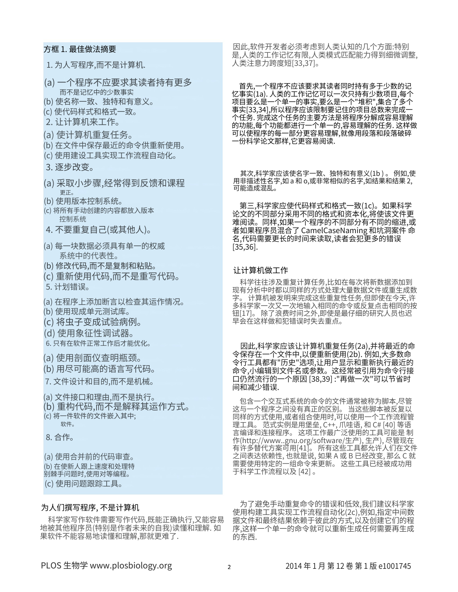
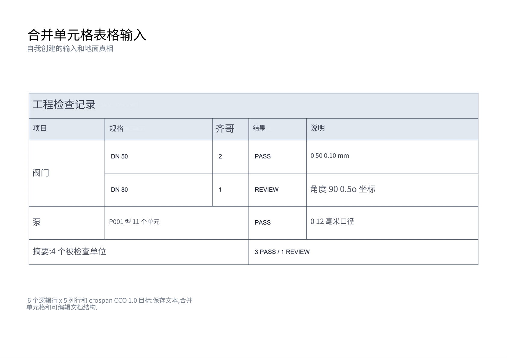

# 复用 faithful：保留原页版式的中文 Word

[首页](../README.md) · [完整运行记录](../artifacts/local-faithful-20261027/run.json) · [历史单栏对照](english-to-chinese-20261026.md)

2026-10-27，两个固定输入重新执行英文 OCR、Argos 英译中、本项目既有 `faithful` DOCX 导出和独立 LibreOffice 渲染。目标是把中文放回原页的双栏、底色与表格位置。模型误译和遗漏原样保留，没有手工修改译文、DOCX 或预览图。

## 输入、输出与阅读方式

| 案例与用户问题 | 真实输入 | 同次运行的输出 |
|---|---|---|
| PLOS：单栏重排改变了论文的页数与阅读布局 | [第 2 页，200 DPI RGB PNG](../samples/plos-best-practices-page-2.png) | [OCR JSON](../artifacts/local-faithful-20261027/plos/source-ocr.json) → [译后 JSON](../artifacts/local-faithful-20261027/plos/translated.json) → [中文 DOCX](../artifacts/local-faithful-20261027/plos/output.docx) · [PDF](../artifacts/local-faithful-20261027/plos/render/output.pdf) |
| 合并表格：源网格存在，但中文曾因几何检查失败未显示 | [自制扫描 PDF](../samples/merged-table-scan.pdf) | [OCR JSON](../artifacts/local-faithful-20261027/merged-table/source-ocr.json) → [译后 JSON](../artifacts/local-faithful-20261027/merged-table/translated.json) → [中文 DOCX](../artifacts/local-faithful-20261027/merged-table/output.docx) · [PDF](../artifacts/local-faithful-20261027/merged-table/render/output.pdf) |

PLOS 原作：Wilson et al. (2014), *Best Practices for Scientific Computing*, DOI `10.1371/journal.pbio.1001745`，CC BY 4.0；本例是 OCR、机器翻译与排版派生结果。自制表格及独立结构真值为 CC0。[完整署名、来源、输入哈希与许可](../CASE_SOURCES.md)。原生 PDF 文字提取仅作参考；表格真值在预测与导出结束后用于评测。

| PLOS：真实 DOCX 渲染 | 表格：真实 DOCX 渲染 |
|---|---|
|  |  |

## 实际调用与复现条件

完整项目中实际执行的是以下已有入口。`source` 为上表输入；`translation_config` 指向隔离运行生成的配置。这是调用说明，公开包不包含 `DocumentPipeline`、完整翻译后端或导出器，不能把这段当作公开包可直接运行的服务示例。

```python
pipeline = DocumentPipeline()
result = pipeline.process(source, output_format="json", use_layout=True,
                          absolute_position=True, ocr_lang="en",
                          ocr_mode="balanced", ocr_scene="general", vlm_fallback="off")
options = docx_translation_runtime_options(
    result, source, "docx", "faithful", quality_policy="strict")
result = await TranslationPipeline(translation_config).translate_document(
    result, source_lang="en", target_lang="zh", **options)
docx_path = pipeline.render_result(result, "docx", absolute_position=True)
```

导出进程显式设置 `PPOCR_DOCX_RENDERER=faithful`，翻译端也使用 `_faithful_layout` 和 `_preserve_block_boundaries`。严格模式失败时不静默换单栏或 legacy；独立渲染后继续调用现有 `audit_docx_faithful(..., render_preview=True)` 与严格交付检查。生成中间 DOCX 不代表允许交付。

| 条件 | 本次实测 |
|---|---|
| OCR | Python 3.11.16；RapidOCR 3.0.0 / ONNX Runtime 1.19.2；PP-OCRv3 检测、英文 PP-OCRv4 识别；geometry/OpenCV，关闭 VLM 和 RapidTable |
| 翻译 | 同一 Argos `translate-en_zh` 1.9；CTranslate2 4.5.0 CPU int8、SentencePiece 0.2.0；beam 4、length penalty 0.2、输入/输出上限 512 tokens |
| 运行隔离 | Docker `--network none --cpus=4 --memory=10g`；源码快照、输入、模型、字体只读；输出独立；不读取现有 `.env` |
| 翻译连接 | 同一禁网容器的 loopback HTTP 适配器，复用项目已有后端协议；不是外部云 API，也不是另跑第三方演示 |
| 字体 | 既有静态 Noto TTF，推理与独立渲染一致；检查实际嵌入子集和字形；[来源与 OFL](../CASE_SOURCES.md#2026-10-27-原页版式中文产物与字体) |
| 独立渲染 | LibreOffice 7.4.7.2 / Poppler 22.12.0；`render_docx.py --emit_pdf --dpi 144`；另一个禁网容器、2 CPU / 4 GiB |

模型和依赖准备需要联网或既有缓存；此次推理、翻译、导出和渲染均在禁网环境完成。完整系统需要与记录匹配的源码、模型、字体及依赖，不能只复制一个环境变量便获得相同结果。每例的 `execution.json` 保存实际参数、模型哈希、依赖、未提交状态及执行源码摘要；`model-responses.json` 保存请求和原始响应。

公开包可直接复核保存结果，不需要模型或第三方 Python 包：

```bash
python -S -X utf8 -B tools/verify_translation.py --record artifacts/local-faithful-20261027/run.json
python -S -X utf8 -B tools/verify_demo.py
```

结果写入终端；`ok=true` 只表示证据一致。此命令不执行 OCR、翻译、渲染，也不重复视觉审查。输入/文件摘要、字体记录、实际渲染审计与视觉结论分开核验；源表格分数从保存的 OCR JSON 重新计算。

## 修复为什么能复用原有版式

- **DPI 传递：** 图片解码逐帧保留有效 X/Y DPI 和旋转后的物理尺寸。缺失时记录 `renderer_default`，沿用各渲染器原默认值；没有把全局默认改成 200。
- **段落与实际行数：** 用同栏中心／基线距离识别连续正文，同行碎片从左到右连接；跨物理行才换行。保留标题、编号、缩进和说明框边界，避免重叠 OCR 框拆段或虚增源行数触发缩字。
- **底色与文字边缘：** 长线保护区分大片均匀蓝底和真实细线；根据 OCR 到背景的比例扩展同一字形的浅色边缘，仍限制在源行区域内，保护抗锯齿表格线。
- **表格几何：** 从局部共享边界的缺线证据恢复矩形合并，多种二值化交叉确认，再复用现有源字形字号校准。记录具体单格失败，保留整份严格检查。
- **混排与原文保留：** 日期不再被排版器缩写；拟合需考虑真实渲染中的中西文边界间距，不能只凭字体测量的 `fits=True` 宣称内容显示完整。

这些修改位于完整项目内部，没有新增公共 API。公开的 8 个算法片段未改动，模型、业务排版代码与私有运行脚本不随包发布。

## 验收范围与保留的问题

最终全链路重跑的两份均为 **1 页**，现有严格交付审计均为 `passed=true`、0 违规。两个助手分别对照原图查看全部原尺寸 PNG，未见叠字、裁切、页外溢出或源英文残影；结论为 `passed_for_page_layout`，范围仅限这两份当前 LibreOffice 渲染。

| 检查层 | PLOS | 合并表格 |
|---|---|---|
| 字体与排版 | 嵌入成功；51 个原生定位文字区域；双栏、蓝底、标题及完整页脚保留 | 嵌入成功；16 个定位区域；横向页面与表格位置、边界保留 |
| 来源覆盖 | 111/111 条来源记录由译文覆盖；不是 111 个独立中文段落，也不是准确率 | 23 条来源中 16 条写入、7 条保留；13 个表格区域含 12 个中文译格和 1 个数值串，另有 3 个非表格组 |
| 原文识别与结构 | 没有独立人工全文真值，不报告准确率 | 源 OCR 文字 14/21 格完全匹配；14/203 字符编辑；位置与跨度 21/21，5 合并正确、无多报或漏报 |
| 翻译质量 | 需要校对，保留真实误译与遗漏 | 需要校对，保留真实误译与工程符号错误 |

具体页面、字体、源内容覆盖、失败区域和视觉判断见 [PLOS 审计](../artifacts/local-faithful-20261027/plos/render-audit.json)、[表格审计](../artifacts/local-faithful-20261027/merged-table/render-audit.json)和[逐页视觉记录](../artifacts/local-faithful-20261027/visual-review.json)。自动交付检查与助手目视检查互相补充，不是独立人工校对或翻译准确率。

表格的 6×5 逻辑网格对应 21 个物理格、5 处合并；[源 OCR 逐格评分](../artifacts/local-faithful-20261027/merged-table/source-table-score.json)分开报告文字和结构。原数量 `2`、`1` 的 OCR 格仍为空，背景可见不能算识别成功。`PASS`／`REVIEW`、部分型号和汇总内容按既有保护策略保留在原图；不能说全文汉化。

译文仍有 `Qty → 齐哥`、`ground truth → 地面真相`、`Turn bugs into test cases → 将虫子变成试验病例` 等误译；`Not an OCR result` 未译出，工程 `Ø、±、°` 仍有识别错误。完整写入已生成的中文，不代表原文语义没有遗漏。本例没有用人工译文替换模型结果。

表格使用**原背景网格与原生定位文字**，DOCX 中没有原生 `w:tbl`。字体、字重、局部字号与段落密度也不等同原件；不声称像素级复刻、全表可编辑或 Microsoft Word 交互编辑已验收。严格多帧仍明确拒绝，非等轴 DPI 的完整物理尺寸消费只覆盖 faithful，本轮两个单页不能推广到所有格式。

[旧三页单栏版本](english-to-chinese-20261026.md)、[原文导出修复](docx-export-fix-20261026.md)、[首次 CPU 失败](local-cpu-20261026.md)原样保留。本轮开发中的缺 DPI、字体、容量失败、日期裁切和残影诊断也保留在本地，没有作为通过素材发布。两例不构成总体性能或准确率结论。
