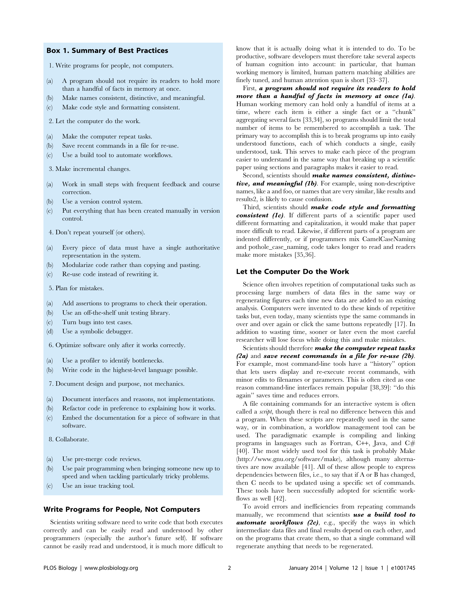
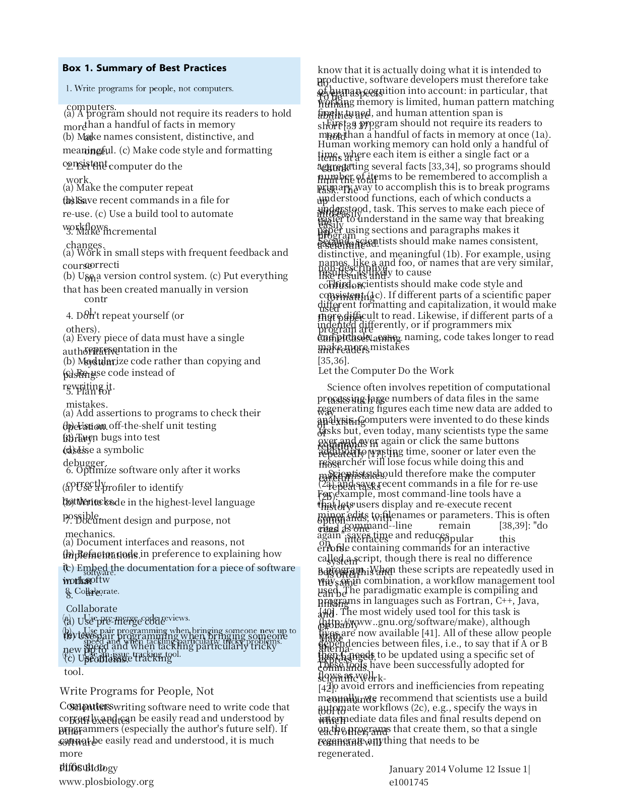
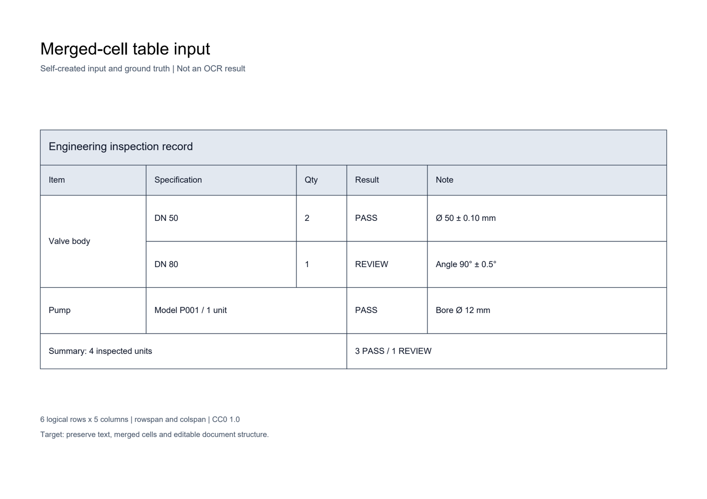
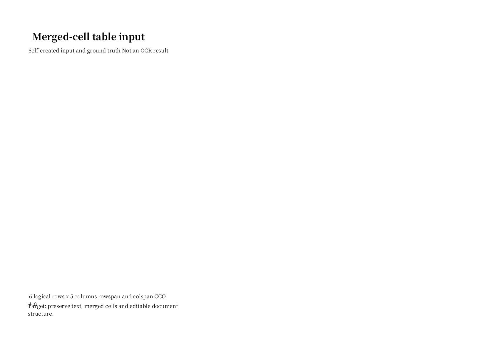

# 本地 CPU 实测：公开正文与合并表格

[首页](../README.md) · [运行指南](../docs/GETTING_STARTED.md) · [完整运行记录](../artifacts/local-20261026/run.json) · [来源与许可](../CASE_SOURCES.md)

2026-10-26，在本机 Docker 的禁网容器中，使用当前完整项目处理两个公开输入，再将同次识别结果导出为 DOCX。两例均生成了 JSON 与 DOCX，流水线未报告运行错误；**两份 DOCX 经 LibreOffice 实际渲染后，视觉验收均未通过。** 本页保留原始产物，没有手工修字、调整版式或用其他模型的结果替换。

## 结果概览

| 检查项 | PLOS 正文页 | 自制合并表格 |
|---|---|---|
| 用户问题 | 从多栏扫描页获取文字，再检查文档输出 | 检查尺寸字符、数量列与合并表格是否被正确还原 |
| 实际输入 | 原 PDF 第 2 页的 200 DPI RGB PNG | 已有纯图像扫描 PDF |
| 流水线中的输入类型 | `image` | `scan_pdf` |
| 块内 OCR 文字行 | 103 | 23 |
| 独立质量参考 | 无人工校订的整页金标准，不报告全文准确率 | 自制的 21 格、5 处合并真值 |
| 结构结果 | 无结构化表格；含文字与保留图像区域 | 预测 30 格，所有跨度均为 1，5 处合并全部漏检 |
| DOCX 包结构 | 有原生文字与图像，0 个原生表格 | 1 个原生表格；`gridSpan=0`、`vMerge=0` |
| 实际渲染 | 1 页；正文大量重叠、断行，蓝色摘要背景仅局部保留 | 1 页；表格主体未显示，页脚重叠 |

文字行数仅统计保存 JSON 的 `pages → blocks → text_lines`，不重复计算图像叠加文字和表格单元格副本。它既不是准确率，也不代表所有原文字都已完整识别。DOCX 的原生节点存在，同样不能证明版式或编辑体验已经达标。

## 案例一：PLOS 多栏正文

来源为 Wilson 等的 *Best Practices for Scientific Computing*（PLOS Biology，2014，CC BY 4.0）。只将官方 PDF 第 2 页的整页 PNG 送入 OCR；原生 PDF 文字另存为[参考提取](../samples/plos-best-practices-page-2-reference.txt)，未用于替换识别结果，也不是人工金标准。[署名、许可、输入哈希与制备参数](../samples/plos-best-practices-source.json)

| 输入：200 DPI，1701 × 2197 | DOCX 的真实渲染：视觉验收失败 |
|---|---|
|  |  |

结果中可检查识别文字、框位置和块类型；例如文字列表保留了 `Make names consistent, distinctive, and meaningful.` 等条目。首页及这里的图片均来自实际输入与导出文件，未生成模拟界面。

可见问题包括正文行重叠、词语被拆到下一行，以及摘要背景只保留上下两块。存在保留图像区域，不能称整页内容都已转换为可编辑文字。尚未完成独立阅读顺序标注或 Microsoft Word 客户端验收。

[原始 PDF](../samples/plos-best-practices-source.pdf) · [OCR 输入 PNG](../samples/plos-best-practices-page-2.png) · [原始 JSON](../artifacts/local-20261026/plos/output.json) · [识别文字](../artifacts/local-20261026/plos/recognized.txt) · [DOCX](../artifacts/local-20261026/plos/output.docx) · [渲染 PDF](../artifacts/local-20261026/plos/render/output.pdf) · [执行记录](../artifacts/local-20261026/plos/execution.json)

## 案例二：合并表格与工程字符

输入为仓库自制 CC0 表格，包含 6 行 × 5 列、21 个物理单元格、5 处合并关系和 `Ø、±、°` 等字符。使用原有扫描输入，不因结果不理想更换样本或修改真值。

| 输入 | DOCX 的真实渲染：视觉验收失败 |
|---|---|
|  |  |

本次关闭 RapidTable，实际使用 `opencv_grid` 几何回退。它输出 30 个普通单元格，没有还原合并关系。

| 按独立真值复算 | 结果 |
|---|---:|
| 文字完全匹配 | 13 / 21 格 |
| 字符编辑距离之和 | 24 / 203 个参考字符 |
| 对真值锚点的位置及跨度匹配 | 16 / 21 格 |
| 预测单元格总数 | 30，真值为 21 |
| 合并关系 | TP=0、FP=0、FN=5 |

评分仅合并空白，不合并 Unicode 字符。识别中有 `Ø → 0`、`±` 丢失、数量列遗漏等问题；16/21 的锚点匹配不能掩盖多出的单元格及全部合并漏检。DOCX XML 虽有一个原生表格，但它在本次 LibreOffice 页面中没有显示。

[扫描 PDF](../samples/merged-table-scan.pdf) · [原始 JSON](../artifacts/local-20261026/merged-table/output.json) · [识别文字](../artifacts/local-20261026/merged-table/recognized.txt) · [逐格评分](../artifacts/local-20261026/merged-table/table-score.json) · [DOCX](../artifacts/local-20261026/merged-table/output.docx) · [渲染 PDF](../artifacts/local-20261026/merged-table/render/output.pdf) · [执行记录](../artifacts/local-20261026/merged-table/execution.json)

## 如何核验和重跑

公开仓库提供离线核验，不包含完整服务端。获取源码后，在公开仓库根目录运行：

```bash
python -S -X utf8 -B tools/verify_local.py
python -S -X utf8 -B tools/verify_demo.py
```

第一条检查本次输入及产物的哈希、块内文字行数、DOCX XML、渲染文件，并从原始流水线 JSON 复算新表格分数。第二条同时检查历史 GPU 与本次 CPU 记录，结果分别保存。输出写到终端；核验器不联网、不加载模型、不重新渲染。`ok=true` 表示证据一致，**不改变 `visual_acceptance=failed`**。

本次完整系统的实际构建命令如下；需拥有未公开完整项目，不能在精选代码仓库中执行：

```bash
docker build --target onnx-only --build-arg PPV5_RAPIDOCR_ONNX_PROFILES=ch,en -t pp-v5-showcase:local .
```

验证脚本在 `--network none --cpus=4 --memory=8g` 的容器中，从独立工作目录调用以下现有接口；输入只读挂载、输出隔离，不读取现场 `.env`：

```python
pipeline = DocumentPipeline()
result = pipeline.process(
    input_path, output_format="json", use_layout=True, absolute_position=True,
    ocr_lang="en", ocr_mode="balanced", ocr_scene="general", vlm_fallback="off",
)
pipeline.render_result(result, "docx", absolute_position=True)
```

完整项目和私有验证脚本不随公开包发布；上面展示实际调用接口，不声称公开仓库可以重新启动该流水线。依赖、请求设置、有效模式参数与每例执行信息均保存在 `execution.json`。请求侧长边设置为 1600，`balanced` 模式的有效上限为 2048；应以记录中的有效参数解读结果。

## 环境、来源与取舍

- 宿主 CPU：AMD Ryzen 9 9950X；Docker Linux AMD64，单容器限制 4 CPU / 8 GiB。
- Python 3.11.16、RapidOCR 3.0.0、ONNX Runtime 1.19.2；实际检测模型为 `multi_PP-OCRv3_det_infer.onnx`，英文识别模型为 `en_PP-OCRv4_rec_infer.onnx`。模型权重与检测识别算法来自第三方。
- 本项目执行输入分类、OCR 适配、几何/OpenCV 处理、结构化结果保存和 `semantic_layout` DOCX 导出。RapidTable 与 VLM 均关闭，这条轻量路径的结果不代表其他后端表现。
- 原始响应还带有默认 Paddle `model_files` 缺失审计项；它们不是本次实际使用的模型。实际身份以[运行记录](../artifacts/local-20261026/run.json)中的 ONNX 文件名及 SHA-256 为准。
- 独立渲染器：LibreOffice 7.4.7.2、Poppler 22.12.0、pdf2image 1.17.0；原样使用 `render_docx.py`，以 144 DPI 输出页面 PNG。渲染也在禁网容器中执行，原始 DOCX 未改写。
- 首次构建、模型和字体准备需要联网；本次只验证准备完成后的两例断网运行，不扩展为所有功能都支持离线的承诺。
- 每例只执行一次，不报告 P50/P95，也不与旧 GPU 记录作性能排名。源码为带既有未提交修改的工作区，记录提交号及执行文件摘要，不仅凭提交号声称可以复现全部源码。

所有输出页面均与输入进行了目视对照。上述质量记录为本次助手检查，不是独立人工验收；未运行翻译、VLM、可搜索 PDF 或 Microsoft Word 验证。后续需要分别修复识别、合并关系和 DOCX 排版，再重新执行及保留新的结果，不能覆盖本次失败记录。
