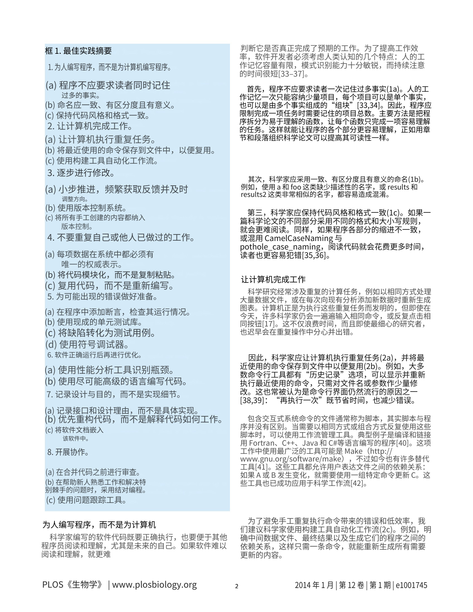
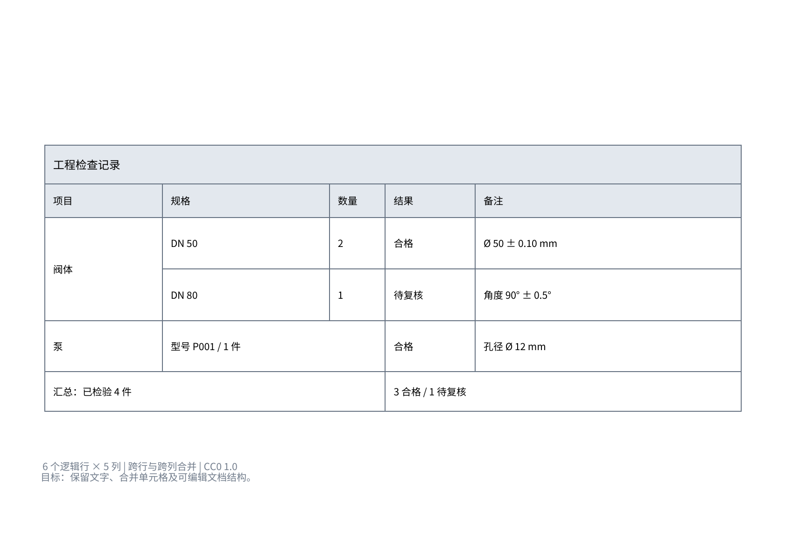

# 中文 Word 案例（2026-10-27）

对照英文原页，查看双栏论文和原生 Word 表格。原始 OCR、模型响应和历史评分单独保存在[模型实测](faithful-translation-20261027.md)中；最终文档是保存结果的后续内容与格式修订，不作为模型新输出。

| 输入与场景 | 中文产物 | 核查结果 |
|---|---|---|
| [PLOS 第 2 页](../samples/plos-best-practices-page-2.png)：双栏正文、编号摘要框、软件名与引用 | [中文 DOCX](../artifacts/reviewed-translation-20261027/plos/output.docx) · [译文 JSON](../artifacts/reviewed-translation-20261027/plos/reviewed.json) · [预览 PDF](../artifacts/reviewed-translation-20261027/plos/render/output.pdf) | 一页双栏、蓝底与完整页脚；原有严格审计 0 违规，文件未变 |
| [自制表格](../assets/merged-table-input.png)：跨行／跨列合并、数量、状态与公差 | [原生表格 DOCX](../artifacts/table-display-20261027/output.docx) · [逐格内容](../artifacts/native-table-20261027/targets.json) · [预览 PDF](../artifacts/table-display-20261027/render/output.pdf) | 一页；1 个原生表格、6×5 网格、21 个单元格与 5 处合并；21 格原生文字逐一匹配 |

下载原文：[PLOS 完整论文 PDF](../samples/plos-best-practices-source.pdf) · [表格扫描 PDF](../samples/merged-table-scan.pdf)。

当前展示页已移除英文与中文顶部的标题、说明文字；原始输入与带标题的历史版本继续保留。表格 XML、表格与页脚显示像素均未改变，详见[本次展示调整](../artifacts/table-display-20261027/run.json)。

## 实际预览





## 原生表格如何生成

本次复用现有 `SemanticLayoutWordBuilder._add_floating_table()`，消费已保存的 21 个预测格及 5 处合并关系。移除旧表格背景和 17 个表内定位文字区域，建立真正的 Word 单元格、边框与跨格合并；初版保留标题、说明和页脚这 3 个表外文字区域；当前展示版按要求移除前两处，仅保留页脚。结构真值只用于生成后的独立验收，不参与构建。

中文内容沿用前一版。`DN 50／DN 80`、状态和汇总现在均为原生格内文字；原始 OCR 为空的数量 `2／1` 根据原图补入文档，来源单独记录，原始 OCR 与模型响应不改写。没有修改应用代码，也没有重新 OCR 或调用翻译模型。[执行与补字记录](../artifacts/native-table-20261027/execution.json) · [运行参数与文件摘要](../artifacts/native-table-20261027/run.json)

使用同批静态 Noto 字体，文档处理容器为 4 CPU／10 GiB，独立渲染为 2 CPU／4 GiB，均禁网。实际渲染命令为：

```bash
python /renderer/render_docx.py /work/output.docx --output_dir /work/render --emit_pdf --dpi 144
```

`/renderer` 为隔离环境中的本地工具，不是公开包提供的入口。LibreOffice 7.4.7.2／Poppler 22.12.0 输出一页 PDF 和 PNG；实测后仅对文档浮动表格的水平锚点增加 5.9 pt，并再次渲染验收。最终边框与保存的源表坐标偏差小于 0.55 pt；这不等于字体或整页像素一致。

## 分项验收

| 检查 | 实际结果 |
|---|---|
| 原生结构 | `w:tbl=1`，6 行／5 列网格，21 个起始单元格；XML 有 22 个 `w:tc`，其中 1 个是跨行合并延续格；5 处合并全部匹配 |
| 格内内容 | 21 个单元格的原生文字逐格匹配，同次 PDF 的对应单元格区域也 21/21 匹配；数量 2／1、DN 标签和工程字符均在格内 |
| 对象类型 | 表内没有图片、文字框或定位段落；整份 DOCX 无图片；当前展示版仅保留 1 个页脚定位文字区域 |
| 独立检查 | 原生初版的 131 项结构检查通过；当前表格 XML 字节不变，21 格及页脚两行全文与位置再次核对通过，逐页查看未见漏字、叠字、裁切或溢出 |

[当前展示版检查](../artifacts/table-display-20261027/execution.json) · [原生初版结构检查](../artifacts/native-table-20261027/structure-checks.json) · [原生初版逐格审计](../artifacts/native-table-20261027/native-audit.json)

PLOS 沿用之前的一页版本，111 条来源记录、51 个定位文字区域，仍采用原页背景与定位文字；[其运行记录](../artifacts/reviewed-translation-20261027/run.json)单独保存。本轮没有用原生表格的专项检查替代或改写历史 `faithful` 审计。

## 范围与历史版本

原生单元格、边框和合并结构已通过文件级检查；Microsoft Word 中实际输入、调整列宽和跨客户端保存尚未交互验收。字体、局部字号与源页有差异。结果仅对应这个固定表格，不代表完整服务可以自动将任意扫描件转换为无误的可编辑表格，也不是模型准确率或独立人工认证。

[旧背景加定位文字版](../artifacts/status-translation-20261027/merged-table/output.docx)、[状态补译记录](../artifacts/status-translation-20261027/run.json)及[原始模型实测](faithful-translation-20261027.md)均保留。公开包仍只有原有 8 个精选算法，完整翻译和排版服务不公开。默认[快速开始](../README.md#快速开始)核验冻结证据；`python -S -X utf8 -B tools/check_publication.py` 核对最终文件清单与哈希，不判断翻译质量。

PLOS 来源：Wilson G 等（2014），*Best Practices for Scientific Computing*，PLOS Biology 12(1): e1001745，DOI `10.1371/journal.pbio.1001745`，CC BY 4.0。自制表格沿用 CC0 1.0，内嵌字体沿用 Noto OFL；完整[来源与许可](../CASE_SOURCES.md)继续适用。
