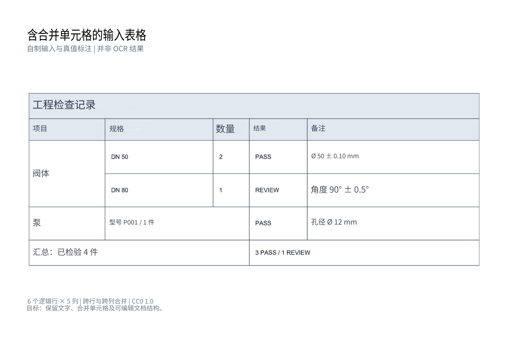

# 中文 Word 案例（2026-10-27）

对照英文原页，查看双栏论文和合并表格的最终中文文档。原始 OCR、模型响应和历史评分单独保存在[模型实测](faithful-translation-20261027.md)中；最终文档的生成参数与内容版本见[导出记录](../artifacts/reviewed-translation-20261027/run.json)和[版本记录](../artifacts/reviewed-translation-20261027/corrections.json)。

| 输入与场景 | 中文产物 | 核查结果 |
|---|---|---|
| [PLOS 第 2 页](../samples/plos-best-practices-page-2.png)：双栏科学计算论文，包含编号摘要框、软件名与引用 | [中文 DOCX](../artifacts/reviewed-translation-20261027/plos/output.docx) · [译文 JSON](../artifacts/reviewed-translation-20261027/plos/reviewed.json) · [预览 PDF](../artifacts/reviewed-translation-20261027/plos/render/output.pdf) | 一页双栏、蓝底及完整页脚；严格审计 0 违规 |
| [自制表格](../assets/merged-table-input.png)：工程检查记录，包含跨行／跨列合并、数量与公差 | [中文 DOCX](../artifacts/reviewed-translation-20261027/merged-table/output.docx) · [译文 JSON](../artifacts/reviewed-translation-20261027/merged-table/reviewed.json) · [预览 PDF](../artifacts/reviewed-translation-20261027/merged-table/render/output.pdf) | 一页、表格可见、21 个物理格与 5 处合并边界；严格审计 0 违规 |

下载原文：[PLOS 完整论文 PDF](../samples/plos-best-practices-source.pdf) · [表格扫描 PDF](../samples/merged-table-scan.pdf)。

## 实际预览




## 执行与复核范围

使用已保存的文档数据，复用 `DocumentPipeline.render_result(..., 'docx', absolute_position=True)` 及静态 Noto 字体。最终导出和独立渲染均在禁网容器中执行：导出使用 4 CPU／6 GiB，渲染使用 2 CPU／4 GiB；这一步没有重新运行 OCR／翻译模型或读取本地 `.env`。

独立环境的实际渲染命令为：

```bash
python /helper/render_docx.py /input/output.docx --output_dir /work/renders/plos --emit_pdf --dpi 144
python /helper/render_docx.py /input/output.docx --output_dir /work/renders/merged-table --emit_pdf --dpi 144
```

两条命令在各自容器中挂载对应 DOCX；`/helper` 为本地渲染工具，**不是公开包提供的入口**。完整私有导出器也不随此包发布。读者可以直接下载上述文件查看；公开包仍可按[快速开始](../README.md#快速开始)核验原始实测，另用 `python -S -X utf8 -B tools/check_publication.py` 检查最终文档的显式文件清单与哈希。

LibreOffice 7.4.7.2／Poppler 22.12.0 以 144 DPI 渲染，两份均为一页。最终 PNG 全页目视检查未见重叠、裁切、溢出或中文缺字；原有严格审计均通过。PLOS 111 条来源记录覆盖、51 个定位文字区域；表格 23 条来源记录中 17 条写入、6 条保留，16 个定位文字区域。计数口径不同，不能把它们当成翻译准确率。[完整记录](../artifacts/reviewed-translation-20261027/run.json) · [逐页审阅](../artifacts/reviewed-translation-20261027/visual-review.json)

## 仍然保留的边界

这些页面用于检查文档呈现，不构成模型准确率、独立人工认证或通用版式保证。原始 OCR 分数与模型输出继续保留。公开包只提供原有 8 个精选算法，不包含完整翻译或排版服务。

表格仍是原背景网格与原生定位文字，`w:tbl=0`。`PASS／REVIEW`、`DN` 标签、汇总状态和数量 `2／1` 保留为英文／数字背景，并非全文汉化或全表可编辑。PLOS 字体、局部字号与原文有差异；Microsoft Word 交互编辑尚未验证。页脚“可编辑文档结构”是原样本目标的翻译，不是本例已实现的承诺。

PLOS 内容来源：Wilson G 等（2014），*Best Practices for Scientific Computing*，PLOS Biology 12(1): e1001745，DOI `10.1371/journal.pbio.1001745`，CC BY 4.0。派生文件包含中文译文与文字排版；自制表格仍按 CC0 1.0。完整[来源、许可与字体说明](../CASE_SOURCES.md)继续适用。
