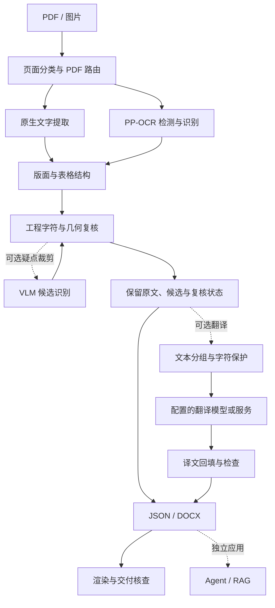
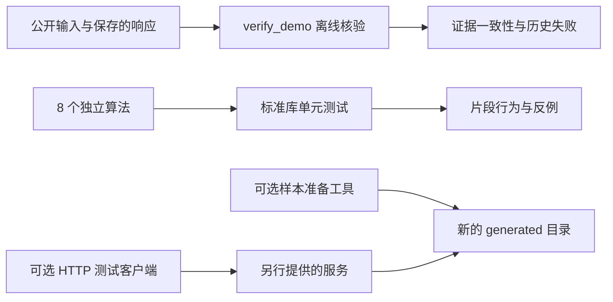

# 架构与公开范围

[首页](../README.md) · [快速开始](GETTING_STARTED.md) · [算法说明](../examples/README.md) · [限制](LIMITATIONS.md)

本仓库从完整文档处理项目中提取 8 个可独立运行的算法，配合真实输出和离线核验。公开内容围绕“输入是什么、结果从哪里来、哪些检查已经通过”组织；没有模型加载器、HTTP 服务端、后台队列或整页业务调度。

## 完整系统的背景流程

以下图示解释公开算法在完整系统中的位置。除公开片段和保存的证据外，图中的服务组件不在本仓库内。

工程 VLM 仅处理可定位的疑似错误区域，是可选研究与接入方向。模型一致、较高置信度或合法公式语法都不能单独消除工程字符疑点。Agent / RAG 是[独立展示项目](https://github.com/YSADF/agent-rag-showcase)，不是本仓库运行前提。

翻译是完整项目中已有的可选处理阶段：分析结果交给 `TranslationPipeline.translate_document()`，按配置调用翻译后端，再将译文回填到结果副本供导出使用。它需要另行配置模型或服务；默认公开核验命令不执行这一步。[2026-10-26 英译中历史案例](../cases/english-to-chinese-20261026.md)实际使用 Argos 英中模型、CTranslate2 和本地 HTTP 适配器，在禁网容器中执行；模型、适配器及完整编排仍未公开。该轮采用 `semantic_layout`，译文超出源框容量时转成原生流式分页，因此放弃了原版几何；保留其单栏产物用于对照。

### 2026-10-27 原页版式路径

[本轮案例](../cases/faithful-translation-20261027.md)复用完整项目已有的 `faithful` 渲染器，翻译分组与最终导出均显式选择同一模式，并记录 `strict` 质量策略。[运行记录](../artifacts/local-faithful-20261027/run.json)分别保存模式、源文件与代码身份、模型输出、字体、渲染和验收结果；这里不以构建器返回文件作为交付通过的依据。

- **页面坐标**：传递图片实际 DPI 与物理页尺寸，使 OCR 像素坐标和 Word 磅值使用同一尺度；`absolute_position=True` 本身不等于选择了 `faithful`。
- **文字分组**：结合文字中心、基线和同栏阅读关系组织段落与条目，保留源行身份；在原区域内测量、换行与适配，不能为避开溢出静默改成单栏或增加页面。
- **表格几何**：整页投影提出网格轴，再根据局部共享边界的实际线段支持恢复合并跨度。仅接受有闭合矩形证据且多种二值化一致的合并，不依据空文字猜跨度，也不把人工真值输入预测过程。
- **背景与源字**：区分蓝底文本面板、字形和线条，擦除范围受源字形身份约束；保留源网格与图形，再放置原生译文。底色面板不能因为有明显边缘就被当成需要保留全部英文的图形。
- **字体与交付**：测量、DOCX 嵌入和独立渲染使用同一套静态 TTF 字体；校准 OCR 估计字号不能替代正确的物理格或源字框。容量、源字清除、译文覆盖、字体和逐页视觉检查分别记录，失败保留诊断产物并由严格交付检查处理。

此路径的表格由**原页背景与原生定位文字**组成，不是 Word 原生表格。部分数字、型号及 `PASS`／`REVIEW` 状态按现有策略保留为栅格内容；可见并不等于 OCR 已识别或能够逐格编辑。翻译质量、版式显示及实际编辑行为仍是不同的验收项目，具体限制见[限制说明](LIMITATIONS.md)。完整修复实现仍在私有项目中，公开算法保持原有 8 个。

以上描述冻结的模型与导出路径。[当前展示文档](../cases/reviewed-translation-20261027.md)另复用已有 `SemanticLayoutWordBuilder._add_floating_table()`，将保存的表格数据转成原生单元格与合并结构，格内文字不再放在背景或定位框中。中文状态和两处数量属于保存文档的内容修订；这次操作没有修改应用代码，也不表示原模型遗漏或自动保护规则已修复。PLOS 仍沿用背景加定位文字。

## 本项目与第三方组件的分工

| 层次 | 第三方提供 | 本项目实现或组织 |
|---|---|---|
| 文字与版面识别 | PaddleOCR、RapidOCR 及相应模型；模型版本以每次记录为准 | 语言和模型路由、后端适配、页面处理及结果元数据 |
| PDF 与图片处理 | PyMuPDF、OpenCV 等读取和图像能力 | 原生文字与扫描内容判断、坐标换算、结构整理 |
| 文档生成 | python-docx、LibreOffice 等写入或渲染能力 | DOCX 模式选择、布局候选、结构及显示核查 |
| 翻译与 VLM | 配置的模型或服务提供候选文字 | 请求编排、片段保护、结果回填及复核；公开包不包含服务端 |

识别模型和底层文件库不是本项目自主研发的模型或格式实现。单独测试某个片段，只能验证该片段的行为，不能替代完整模型、页面和文档的质量验收。

这也解释了两个设计取舍：分析与渲染分开，使同一结构化结果能单独检查文字、表格和导出；原文、候选及复核状态同时保留，避免一次“修正”抹去错误来源。公开示例展示其中的小范围逻辑，完整编排保留在原项目中。

## 本仓库实际运行的路径

默认 Quickstart 只走离线核验和独立测试，不会调用图中的外部服务。PDF 路由的真实文件读取、样本生成和 HTTP 复测分别采用单独的可选依赖。

2026-10-26 的历史本地案例在完整项目中执行 CPU 推理，公开包保存其输入、JSON、DOCX 和执行记录。实际后端为 RapidOCR / ONNX Runtime，使用 PP-OCRv3 检测、英文 PP-OCRv4 识别及几何/OpenCV 结构处理；未启用 RapidTable 或 VLM。这一运行条件与 2026-10-07 的 PP-OCRv6 GPU 历史记录不同，不代表公开片段本身新增了模型加载或完整服务能力。

## 八个算法及边界

| 组件 | 公开能力 | 完整系统中的配套能力 |
|---|---|---|
| [PDF 路由](../examples/pdf_routing.py) | 文字密度统计、路由决策、扫描页风险 | 文件接入、完整转换、逐页业务调度 |
| [Copy-fit](../examples/copy_fit.py) | 有界布局候选与是否容纳的判定 | 真实字体测量、整页排版、DOCX 渲染验收 |
| [字符保护](../examples/literal_guard.py) | 保存和校验已确认的原样片段 | OCR、翻译服务及人工确认流程 |
| [工程评分](../examples/engineering_metrics.py) | 字符级差异及转写／复核状态统计 | 检测框匹配、完整数据集及独立人工真值 |
| [公差关联](../examples/engineering_tolerances.py) | 按位置关联实际观测到的尺寸与偏差 | 检测、分行复识别及全页结果管理 |
| [VLM 证据](../examples/vlm_evidence.py) | 原始识别与候选的可追溯保存 | 模型调用、自动选择、页面状态传播 |
| [VLM 几何](../examples/vlm_geometry.py) | 区域坐标与表格跨度检查 | 完整文档适配、检测器对齐、结构修复 |
| [VLM 策略](../examples/vlm_fallback_policy.py) | 风险优先级、失败与关键修改检查 | 模型权重加载、预算调度、跨区域去重与写回 |

独立测试只对公开文件定义的行为负责。将多个片段放在一起不等于重建了完整服务，完整项目的历史指标也不能直接归因于某一个函数。

## 证据如何对应

- `samples/`：公开且有来源说明的输入。DEXPI PDF 的原生文字层是源材料，不是 OCR 或人工校对真值。
- `artifacts/gpu-20261007/`：完整项目当时保存的 OCR 响应、测量、DOCX 与实际渲染。输入哈希把响应对应到具体文件。
- `artifacts/local-20261026/`：该轮 CPU 实测的 JSON、DOCX、执行信息与派生评分；实际模型身份以执行记录的 `models` 文件和哈希为准，不把通用 Paddle 审计中的缺失模型当作实际使用的模型。
- `artifacts/local-docx-fix-20261026/`：修复导出器后重新运行的独立证据；包含原样 JSON/DOCX、渲染、文字及几何对照和限定范围的视觉结论。完整业务修复代码未加入公开包。
- `artifacts/local-translation-20261026/`：历史单栏英中请求及模型响应、译后 JSON、中文 DOCX 和全部渲染页面；`before-reflow/` 保存相同 Argos 模型和译文的旧布局输出，区分模型变化与渲染修复。
- `artifacts/local-faithful-20261027/`：显式 `faithful`／`strict` 路径重新运行的英译中、原页版式 DOCX、字体及独立渲染证据；具体结论以本轮案例和记录为准。
- `artifacts/merged-table-ground-truth.json`：自制表格的人工编写结构和文字真值，用于逐格复算。
- 其他日期的 `artifacts/` 与 `cases/`：后续工程图及 VLM 开发实验。没有再分发许可的原图不随仓库提供。
- `generated/`：本地新样本或新报告，与冻结记录隔离，不参与公开文件清单。

`verify_demo.py` 校验材料对应关系并重新计算表格分数；`verify_local.py` 可用 `--record` 选择保存的运行，分别记入 `local_run` 和 `local_docx_fix`。`verify_translation.py` 核验保存的英中请求响应、中文文字及该运行声明的文档结构：历史单栏结果记为 `local_translation`，原页版式结果记为 `local_faithful`，也可用 `--record artifacts/local-faithful-20261027/run.json` 单独选择后者。核验不能要求 `faithful` 的背景表格伪装成原生 Word 表格。这些工具都不执行新推理；文件和结构检查不能替代视觉或翻译质量验收，也不会覆盖保存的失败结论。

## 追溯与发布

[CODE_PROVENANCE.json](../CODE_PROVENANCE.json) 记录算法片段来源和摘要，帮助解释选取范围；它不公开未包含的源码，也不是完整项目可复现的承诺。

发布清单记录当前公开文件的字节数和 SHA-256，生成物、模型与现场配置不进入发布目录。清单核验用于确认文件一致性，不能代替许可审查或实验正确性判断。具体操作见[发布说明](PUBLISHING.md)，素材与代码分别遵循[分项许可](../LICENSE.md)。
