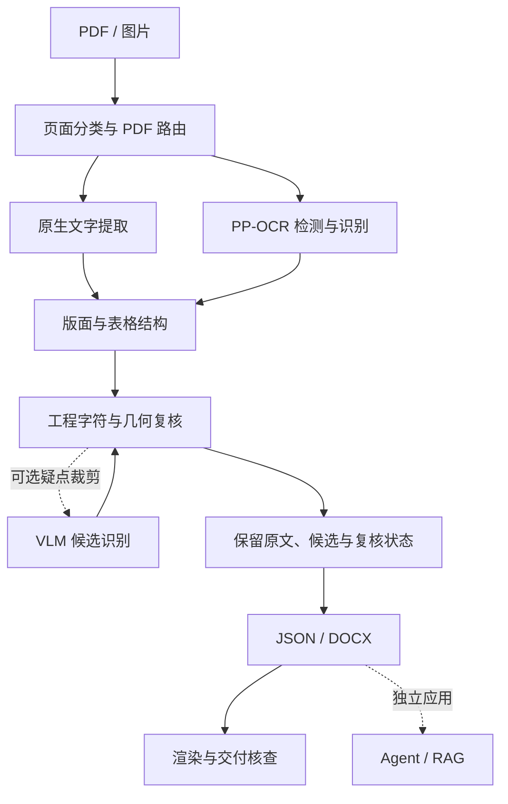
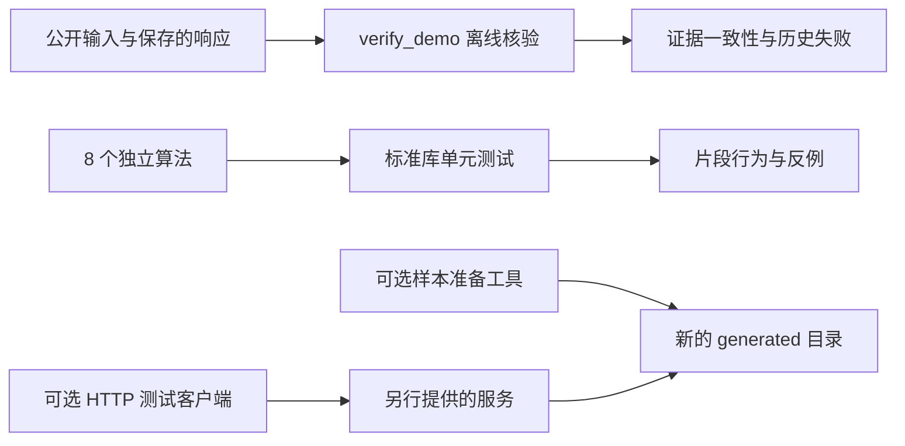

# 架构与公开范围

[首页](../README.md) · [快速开始](GETTING_STARTED.md) · [算法说明](../examples/README.md) · [限制](LIMITATIONS.md)

本仓库从完整文档处理项目中提取 8 个可独立运行的算法，配合真实输出和离线核验。它不是完整项目的轻量部署版：没有模型加载器、HTTP 服务端、后台队列或整页业务调度。

## 完整系统的背景流程

以下图示解释公开算法在完整系统中的位置。除公开片段和保存的证据外，图中的生产组件不在本仓库内。

工程 VLM 仅处理可定位的疑似错误区域，是可选研究与接入方向。模型一致、较高置信度或合法公式语法都不能单独消除工程字符疑点。Agent / RAG 是[独立展示项目](https://github.com/YSADF/agent-rag-showcase)，不是本仓库运行前提。

## 本仓库实际运行的路径

默认 Quickstart 只走离线核验和独立测试，不会调用图中的外部服务。PDF 路由的真实文件读取、样本生成和 HTTP 复测分别采用单独的可选依赖。

## 八个算法及边界

| 组件 | 公开能力 | 完整系统中的配套能力 |
|---|---|---|
| [PDF 路由](../examples/pdf_routing.py) | 文字密度统计、路由决策、扫描页风险 | 文件接入、完整转换、逐页业务调度 |
| [Copy-fit](../examples/copy_fit.py) | 有界布局候选与是否容纳的判定 | 真实字体测量、整页排版、DOCX 渲染验收 |
| [字符保护](../examples/literal_guard.py) | 保存和校验已确认的原样片段 | OCR、翻译服务及人工确认流程 |
| [工程评分](../examples/engineering_metrics.py) | 字符级差异及转写／复核状态统计 | 检测框匹配、完整数据集及独立人工真值 |
| [公差关联](../examples/engineering_tolerances.py) | 按位置关联实际观测到的尺寸与偏差 | 检测、分行复识别及全页结果管理 |
| [VLM 证据](../examples/vlm_evidence.py) | 原始识别与候选的可追溯保存 | 模型调用、自动选择、页面状态传播 |
| [VLM 几何](../examples/vlm_geometry.py) | 区域坐标与表格跨度检查 | 完整文档适配、检测器对齐、结构修复 |
| [VLM 策略](../examples/vlm_fallback_policy.py) | 风险优先级、失败与关键修改检查 | 模型权重加载、预算调度、跨区域去重与写回 |

独立测试只对公开文件定义的行为负责。将多个片段放在一起不等于重建了完整服务，完整项目的历史指标也不能直接归因于某一个函数。

## 证据如何对应

- `samples/`：公开且有来源说明的输入。DEXPI PDF 的原生文字层是源材料，不是 OCR 或人工校对真值。
- `artifacts/gpu-20261007/`：完整项目当时保存的 OCR 响应、测量、DOCX 与实际渲染。输入哈希把响应对应到具体文件。
- `artifacts/merged-table-ground-truth.json`：自制表格的人工编写结构和文字真值，用于逐格复算。
- 其他日期的 `artifacts/` 与 `cases/`：后续工程图及 VLM 开发实验。没有再分发许可的原图不随仓库提供。
- `generated/`：本地新样本或新报告，与冻结记录隔离，不参与公开文件清单。

`verify_demo.py` 校验可公开材料的对应关系并重新计算表格分数，不执行新推理。它对 DOCX 的 ZIP/XML 检查不能替代视觉验收，也不会覆盖保存的失败结论。

## 追溯与发布

[CODE_PROVENANCE.json](../CODE_PROVENANCE.json) 记录算法片段来源和摘要，帮助解释选取范围；它不公开未包含的源码，也不是完整项目可复现的承诺。

发布清单记录当前公开文件的字节数和 SHA-256，生成物、模型与现场配置不进入发布目录。清单核验用于确认文件一致性，不能代替许可审查或实验正确性判断。具体操作见[发布说明](PUBLISHING.md)，素材与代码分别遵循[分项许可](../LICENSE.md)。
